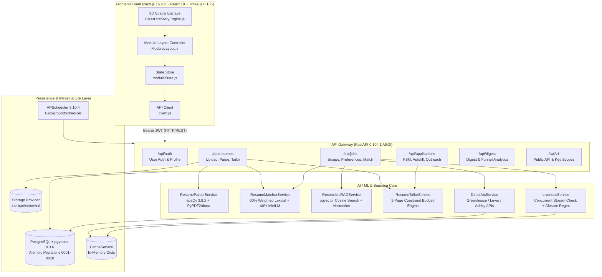

# ClearHire.AI — System Overview & Architecture

> **Target Audience**: Final-year Computer Science / AI-ML engineering student onboarding onto the codebase.  
> **Source-of-Truth**: All package versions, numbers, equations, and behavior are verified directly against `backend/requirements.txt`, `frontend/package.json`, and live source code.

---

## 1. Verified Tech Stack & Pinned Versions

The stack below represents the actual pinned dependencies installed and configured in the repository:

| Layer | Technology | Pinned Version | Why This Choice? (Engineering Rationale) |
|---|---|---|---|
| **Backend API** | FastAPI | `0.104.1` | Asynchronous ASGI framework with native Python type hints, automatic OpenAPI generation, and high concurrency for I/O-bound scraping. |
| **Data Validation** | Pydantic | `2.5.0` (`pydantic-settings 2.1.0`) | Strict runtime type validation and `.env` configuration management. |
| **NLP Entity Extraction** | spaCy | `3.8.2` (`en_core_web_sm`) | Deterministic statistical + rule-based pipeline for extracting candidate names, contact details, and skill sets. |
| **Dense Embeddings** | `sentence-transformers` | `3.2.1` (`all-MiniLM-L6-v2`) | Produces 384-dimensional dense semantic vectors locally with sub-50ms CPU inference, avoiding external API costs. |
| **Vector Database** | PostgreSQL + `pgvector` | `0.3.6` (Extension) | Native relational + vector search using the cosine distance `<=>` operator. |
| **Database Migrations** | Alembic | `1.12.1` | Version-controlled schema migrations tracking 10 distinct revisions (`20260329_0001` through `20261020_0010`). |
| **LLM & Agent Orchestration** | LangGraph & Groq | `langgraph==0.2.53`, `groq==0.19.0` | 2-node linear StateGraph (`parse_step` -> `match_step` -> `END`) in [workflow_service.py:30-60](../backend/app/services/workflow_service.py#L30-L60) and fast Llama inference in [rag_service.py](../backend/app/services/rag_service.py). |
| **Notification Dispatch** | SMTP Email (`smtplib`) | Python Standard Library | Synchronous email dispatch in [email_service.py:33](../backend/app/services/email_service.py#L33) for morning digests. Telegram and WhatsApp are unused model columns in `UserPreference`. |
| **Object Storage & S3** | Boto3 / Local | `boto3==1.34.162` | S3-compatible cloud storage adapter in [storage.py](../backend/app/services/storage.py) with fallback to local filesystem. |
| **Browser Scraping** | Playwright | `playwright==1.40.0` | Headless Chromium engine in [job_scraper_service.py](../backend/app/services/job_scraper_service.py) for dynamic JS-rendered job boards. |
| **Job Scheduling** | APScheduler | `3.10.4` | In-process background scheduler (`BackgroundScheduler`) managing cron-style user digest and automation runs. |
| **PDF Compilation** | ReportLab | `4.2.5` | Headless, programmatic PDF generation calculating precise canvas layout points to guarantee single-page resume exports. |
| **Frontend Framework** | Next.js | `16.4.2` (Pages Router) | Modern React framework with hybrid SSR/CSR capabilities, fast builds, and Turbopack support. |
| **Frontend UI Runtime** | React | `^19.3.0` | Modern React 19 component lifecycle and hooks. |
| **3D Graphics Engine** | Three.js | `^0.186.1` | Native WebGL rendering engine rendering camera waypoints, GLTF office assets, and custom shaders. |
| **Styling** | Tailwind CSS | `^3.3.0` | Utility-first CSS framework for responsive layout styling. |

### Unused Dependencies in Configurations (Technical Debt)

Grep inspection of import statements across the entire codebase revealed four packages declared in dependency files that are currently unreferenced in application source code:
1. **`anthropic==0.7.8`** (in `backend/requirements.txt`): 0 imports across all Python files.
2. **`redis==5.0.1`** (in `backend/requirements.txt`): Configured in [config.py](../backend/app/utils/config.py), but 0 imports in application code; caching is handled in-memory in [cache_service.py](../backend/app/services/cache_service.py).
3. **`selenium==4.15.2`** (in `backend/requirements.txt`): 0 imports in Python code (scraping uses Playwright or requests/bs4; `selenium` only appears as a skill string in test datasets).
4. **`zustand==^4.4.0`** (in `frontend/package.json`): 0 imports across `frontend/src/`; client state is managed via React Context in [moduleState.js](../frontend/src/lib/moduleState.js).

### Node.js Version Discrepancy (CI vs Local Runtime)

- **Local Development / Package Engine**: `frontend/package.json` specifies `"node": ">=24.0.0"`, and local machine runs Node `v24.20.0`.
- **GitHub Actions CI**: `.github/workflows/frontend-build.yml` (line 27) sets `node-version: '20'`.
- **Status**: Discrepancy logged as technical debt for documentation file 08.

### Verified Test Suite Counts (Automated Pytest Record)

The repository's complete backend test suite is executed using pytest:
- **Execution Command**: `.\.venv\Scripts\python.exe -m pytest -q backend/tests`
- **Total Collected Tests**: **117** test items across 33 test modules
- **Unit & Endpoint Tests**: **111 passed** (100% green across auth, parsing, matching, ATS, RAG, tailor, and application workflows)
- **Integration Stress Tests**: **6 skipped** (`test_stress_load.py` phases 1–4, frontend routes, and RSS memory stability; decorated with `@pytest.mark.integration` and configured to gracefully skip when a live server at `http://127.0.0.1:8000` is unreachable)
- **Suite Execution Duration**: ~83.5 seconds on local CPU runtime.

---

## 2. Library & Architectural Clarifications

1. **Custom Weighted Lexical Overlap, NOT `TfidfVectorizer`**:
   - `grep` for `TfidfVectorizer` returns 0 results across the repository.
   - ClearHire does not import scikit-learn. The lexical matching component in [matcher_service.py:149-195](../backend/app/services/matcher_service.py#L149-L195) is a **custom weighted keyword overlap algorithm**:
     - It extracts canonical requirement terms and skill phrases (`_extract_requirement_terms`).
     - It applies discrete multipliers: `1.7x` for curated tech keywords ([line 167](../backend/app/services/matcher_service.py#L167)), `1.5x` for compound phrases with spaces/slashes/pluses ([line 169](../backend/app/services/matcher_service.py#L169)), and `1.0x` for standard terms ([line 170](../backend/app/services/matcher_service.py#L170)).
     - The score is calculated as: `score = (weighted_matched / max(1.0, weighted_required)) * 100`.

2. **Vanilla Three.js, NOT `@react-three/fiber`**:
   - `grep` for `react-three` returns 0 results across the repository.
   - ClearHire does not use React Three Fiber (`@react-three/fiber`) or Drei (`@react-three/drei`).
   - The 3D WebGL spatial enclave in [ClearHireStoryEngine.js](../frontend/src/components/ClearHireStoryEngine.js) mounts **pure Three.js (`import * as THREE from "three"`)** directly inside a React `useEffect` hook, managing its own canvas ref, `requestAnimationFrame` loop, WebGL renderer, GLTF loaders, and custom volumetric shaders.

3. **Client State Architecture**:
   - Application state across modules is orchestrated via custom React Context and `localStorage` synchronization in [moduleState.js](../frontend/src/lib/moduleState.js).

---

## 3. Executive Summary & Problem Statement

Candidates navigating the tech job market encounter two recurring technical bottlenecks:
1. **Aggregator Latency & Expired Requisitions**: Postings aggregated from external portals frequently remain online long after hiring teams close requisitions, resulting in 404s, expired redirects, or applications submitted to unattended third-party staffing pools.
2. **Ungrounded "Auto-Apply" Bots**: Generic automated tools submit unmodified candidate profiles en masse without verifying factual competency matches, triggering spam heuristics and disqualifications.

**ClearHire.AI** addresses both failure modes through an **evidence-first, human-in-the-loop candidate copilot**:
- Sourcing requisitions directly from first-party ATS board APIs (**Greenhouse, Lever, Ashby**) and validating HTTP stream liveness and closure notices before presenting them to candidates.
- Extracting candidate skills deterministically with NLP (**spaCy 3.8.2**).
- Computing a dual-tier lexical + dense vector match score (**Custom Weighted Keyword Overlap + `all-MiniLM-L6-v2`**).
- Gating AI recommendations through a **Reconciled RAG Engine** (dense vector search over `job_postings` combined with deterministic string-matched resume evidence) with strict mathematical abstention thresholds.
- Enforcing physical 1-page constraints on tailored resumes (48 lines, 620 words) with programmatic ReportLab PDF generation.
- Presenting the entire workflow in a responsive **3D WebGL spatial enclave** powered by **Three.js**.

---

## 4. High-Level Architecture Flowchart

---

## 5. Ground-Truth Constants & Thresholds

| Parameter | Value | Location in Codebase | Purpose & Behavioral Impact |
|---|---|---|---|
| **Embedding Dimension** | `384` | [matcher_service.py:77](../backend/app/services/matcher_service.py#L77), [config.py:62](../backend/app/utils/config.py#L62) | Length of dense vector representations generated by `sentence-transformers/all-MiniLM-L6-v2`. |
| **Match Hybrid Split** | `60% Lexical / 40% Embedding` | [matcher_service.py:293](../backend/app/services/matcher_service.py#L293) | Final score calculation: `round((0.6 * keyword_score) + (0.4 * embedding_score), 2)`. Prioritizes exact skill requirements. |
| **Term Weight: Tech** | `1.7x` | [matcher_service.py:167](../backend/app/services/matcher_service.py#L167) | Boost multiplier applied to curated technical keywords (e.g. Python, PyTorch, Docker). |
| **Curated Tech Keywords** | `51 keywords` | [matcher_service.py:17-48](../backend/app/services/matcher_service.py#L17-L48) | Deterministic list of core programming languages, frameworks, and databases receiving 1.7x matching weight. |
| **Term Weight: Phrases** | `1.5x` | [matcher_service.py:169](../backend/app/services/matcher_service.py#L169) | Boost multiplier applied to compound multi-token phrases containing `/`, `+`, or spaces (e.g. `CI/CD`). |
| **Term Weight: Regular** | `1.0x` | [matcher_service.py:170](../backend/app/services/matcher_service.py#L170) | Standard weight for general terminology. |
| **Resume Line Budget** | `48 lines` | [tailor_service.py:10](../backend/app/services/tailor_service.py#L10) | Hard ceiling on output resume line count to guarantee strict 1-page compliance. |
| **Resume Word Budget** | `620 words` | [tailor_service.py:11](../backend/app/services/tailor_service.py#L11) | Hard ceiling on total words to prevent dense visual crowding. |
| **Bullet Word Budget** | `24 words` | [tailor_service.py:12](../backend/app/services/tailor_service.py#L12) | Maximum word length per bullet point before truncation. |
| **RAG Cosine Threshold** | `0.35` | [config.py:66](../backend/app/utils/config.py#L66), [rag_service.py:312](../backend/app/services/rag_service.py#L312) | Gates individual candidate evidence snippet qualification (`strong_evidence_count`). Snippets with cosine similarity $\ge 0.35$ qualify as supporting evidence. |
| **RAG Ambiguity Margin** | `<= 0.03` | [rag_service.py:270-272](../backend/app/services/rag_service.py#L270-L272) | If `abs(top_evidence[0].sim - top_evidence[1].sim) <= 0.03`, evidence is evaluated as conflicting/ambiguous. |
| **RAG Min Skill Overlap** | `0.50 (50%)` | [config.py:68](../backend/app/utils/config.py#L68), [rag_service.py:401](../backend/app/services/rag_service.py#L401) | Minimum ratio of resume skills confirmed in retrieved evidence; if below, returns `insufficient_skill_evidence`. |
| **RAG Abstain Threshold** | `0.55` | [config.py:67](../backend/app/utils/config.py#L67), [rag_service.py:414](../backend/app/services/rag_service.py#L414) | Gates overall composite confidence score. If composite score < 0.55, marks `abstained = True` with status `low_confidence`. |
| **Authenticity Base Score** | `50.0` | [authenticity_service.py:173](../backend/app/services/authenticity_service.py#L173) | Starting neutral authenticity rating before applying bonuses or penalties. |
| **Direct ATS Bonus** | `+35.0` | [authenticity_service.py:176](../backend/app/services/authenticity_service.py#L176) | Authenticity credit awarded when posting originates from verified first-party ATS board (Greenhouse/Lever/Ashby). |
| **Agency Penalty** | `-40.0` | [authenticity_service.py:194](../backend/app/services/authenticity_service.py#L194) | Score penalty applied when third-party staffing agency keywords are detected. |
| **Ghosting Alert Age** | `14 days` | [applications.py:85](../backend/app/api/applications.py#L85), [applications.py:590](../backend/app/api/applications.py#L590) | Inactivity threshold after which an application in `applied` or `screening` status is flagged as ghosted. |
| **Direct ATS Cache TTL** | `900 seconds (15 min)` | [direct_ats_service.py:332](../backend/app/services/direct_ats_service.py#L332) | Expiration time for cached responses from public ATS API boards. |
| **Curated ATS Registry** | `17 companies` | [direct_ats_service.py:60-80](../backend/app/services/direct_ats_service.py#L60-L80) | Curated tech leaders with verified active public ATS endpoints (Postman, InMobi, Stripe, Replit, etc.). |
| **Official Career Portals** | `34 portals` | [liveness_service.py:19-54](../backend/app/services/liveness_service.py#L19-L54) | Direct fallback company career URLs used when individual job links are closed or dead. |
| **Liveness Closure Keywords** | `12 keywords` | [liveness_service.py:56-69](../backend/app/services/liveness_service.py#L56-L69) | Distinct closure strings checked in the first 8KB of an HTTP response. |
| **Liveness Stream Sample** | `8192 bytes (8KB)` | [liveness_service.py:159](../backend/app/services/liveness_service.py#L159) | Chunk size read from raw HTTP response stream to detect closure notices without downloading large HTML payloads. |
| **Eval Benchmark Set** | `20 pairs, 24 terms` | [reconciled_match_eval_20.json:2-28](../backend/app/evaluation/datasets/reconciled_match_eval_20.json#L2-L28) | Ground-truth dataset containing 20 candidate-job pairs and 24 monitored technical hallucination terms. |

---

## 6. The 10-Line Mental Model

1. **Evidence-First Human-in-the-Loop**: ClearHire is an interactive engineering workbench; automated submissions require explicit human review confirmation.
2. **First-Party Sourcing Over Aggregators**: Postings come directly from company ATS endpoints (Greenhouse, Lever, Ashby), avoiding scraper delays and agency reposts.
3. **Liveness is Active, Not Assumed**: Requisitions are streamed and scanned for 12 closure phrases and HTTP 404/410 codes before reaching the candidate dashboard.
4. **Hybrid Matching Prevents Hallucination**: A 60% deterministic weighted lexical overlap combined with a 40% dense semantic embedding ensures candidate evaluation is rooted in factual skills.
5. **RAG over Job Postings + Deterministic Resume Evidence**: Vector search retrieves relevant job postings from PostgreSQL `pgvector`, while candidate evidence is string-matched against resume text. When individual evidence snippets fall below similarity 0.35 ([rag_service.py:312](../backend/app/services/rag_service.py#L312)), contradictory evidence has a margin $\le 0.03$ ([rag_service.py:270](../backend/app/services/rag_service.py#L270)), or composite confidence is below 0.55 ([rag_service.py:414](../backend/app/services/rag_service.py#L414)), the AI explicitly abstains rather than inventing answers.
6. **Strict 1-Page Physics**: The tailor engine enforces real-world physical constraints (48 lines, 620 words, 24 words/bullet) with programmatic ReportLab PDF compilation.
7. **Transparent Skill Auditing**: Skills required by a job but absent from a resume are marked as `review_required` rather than falsely injected into the candidate profile.
8. **State-Driven Application Lifecycle**: Applications follow a finite state machine (`draft` → `pending` → `review_required` → `reviewed` → `applied`) preventing out-of-order execution.
9. **Automated Ghosting Sentinel**: Inactive applications trigger ghosting alerts at day 14 and immediately suggest active, verified direct ATS alternatives.
10. **Native Three.js Spatial Enclave**: The user interface uses pure Three.js camera waypoints inside React to present stages as focused visual workspaces.
