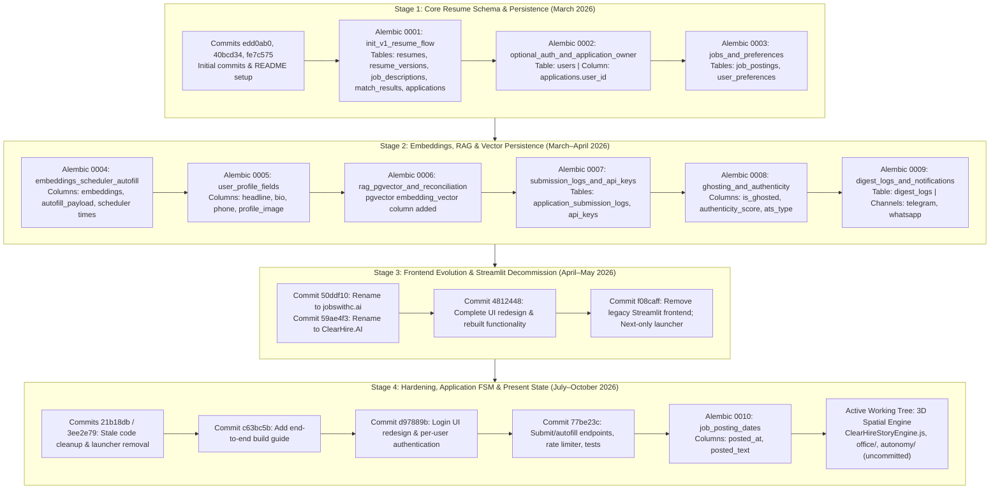

# ClearHire.AI — Project Genesis & Reconstruction Guide

> **Target Audience**: Final-year Computer Science / AI-ML engineering student onboarding onto the codebase.  
> **Source-of-Truth**: Reconstructed strictly from `git log --reverse` and the 10 Alembic database migration files in `backend/alembic/versions/`. Any explanation of developer intent is explicitly labeled `[INFERRED]`.

---

## 1. Verifiable Chronological Progression



---

## 2. Complete Table of All 10 Alembic Database Migrations

| Migration File | Date | Tables Created | Columns Added | Purpose / Notes |
|---|---|---|---|---|
| `20260329_0001_init_v1_resume_flow.py` | 2026-03-29 | `resumes`, `job_descriptions`, `resume_versions`, `match_results`, `applications` | None | Initial V1 schema supporting resume uploads, parsing, versions, and application tracking. |
| `20260329_0002_optional_auth_and_application_owner.py` | 2026-03-29 | `users` | `applications.user_id` | Adds candidate user credentials and associates applications with user accounts. |
| `20260329_0003_jobs_and_preferences.py` | 2026-03-29 | `job_postings`, `user_preferences` | None | Stores scraped job requisitions and candidate search preferences. |
| `20260329_0004_embeddings_scheduler_autofill.py` | 2026-03-29 | None | `resume_versions.embedding`, `job_postings.embedding`, `applications.application_url`, `applications.autofill_payload`, `user_preferences.selected_sources_csv`, `user_preferences.auto_schedule_enabled`, `user_preferences.schedule_time`, `user_preferences.schedule_timezone` | Adds dense JSON vector storage, autofill payloads, and APScheduler cron parameters. |
| `20260330_0005_user_profile_fields_and_account_support.py` | 2026-03-30 | None | `users.full_name`, `users.headline`, `users.location`, `users.phone`, `users.bio`, `users.profile_image_data_url` | Expands candidate profiles for autofill and account management. |
| `20260331_0006_rag_pgvector_and_reconciliation_foundation.py` | 2026-03-31 | None | `resume_versions.embedding_vector`, `job_descriptions.embedding_vector`, `job_postings.embedding_vector`, `match_results.retrieval_score`, `match_results.retrieval_top_k`, `match_results.retrieved_context`, `match_results.reconciliation_confidence`, `match_results.reconciliation_notes`, `match_results.abstain_reason` | Native PostgreSQL `pgvector` foundation with RAG retrieval metrics and abstention reasons. |
| `20260401_0007_add_submission_logs_and_api_keys.py` | 2026-04-01 | `application_submission_logs`, `api_keys` | None | Immutable audit trail for application submission and public developer API keys. |
| `20260402_0008_add_ghosting_and_authenticity_fields.py` | 2026-04-02 | None | `job_postings.source_type`, `job_postings.ghosting_risk`, `job_postings.authenticity_score`, `job_postings.is_direct_employer`, `job_postings.is_evergreen`, `job_postings.ats_provider`, `job_postings.ghosting_signals`, `user_preferences.target_companies_csv`, `user_preferences.exclude_staffing_agencies`, `user_preferences.direct_portals_only`, `user_preferences.max_post_age_days`, `user_preferences.notice_period_days`, `user_preferences.serving_notice`, `user_preferences.current_ctc_lpa`, `user_preferences.expected_ctc_lpa`, `user_preferences.work_mode` | Fields for direct ATS sourcing, authenticity scoring, and 14-day ghosting sentinel. |
| `20260403_0009_add_digest_logs_and_notification_channels.py` | 2026-04-03 | `digest_logs` | `user_preferences.telegram_chat_id`, `user_preferences.whatsapp_number`, `user_preferences.notification_channels_csv` | Multi-channel candidate notifications and morning digest tracking. |
| `20261020_0010_job_posting_dates.py` | 2026-10-20 | None | `job_postings.posted_at`, `job_postings.posted_text` | Requisition publication timestamps for freshness sorting. |

---

## 3. Complete Table of All 20 Git Commits

| Commit Hash | Commit Date | Commit Message | Files Changed | Key Files Touched |
|---|---|---|---|---|
| `edd0ab0` | 2026-03-29 | Initial commit | 1 | `README.md` |
| `40bcd34` | 2026-03-29 | Revise README for ClearHire.ai project | 1 | `README.md` |
| `fe7c575` | 2026-03-29 | Fix DATABASE_URL in README | 1 | `README.md` |
| `5b006c4` | 2026-03-31 | Initial project commit | 122 | Core backend, parser, database, migrations 0001-0004 |
| `50ddf10` | 2026-03-31 | Rename project to jobswithc.ai and update README | 1 | `README.md` |
| `59ae4f3` | 2026-04-01 | Rename project from jobswithc.ai to ClearHire.AI | 1 | `README.md` |
| `4081490` | 2026-04-06 | Initial project commit | 22 | `backend/alembic/versions/20260331_0006...`, `api/jobs.py`, `api/resumes.py` |
| `bea0fe9` | 2026-04-22 | Merge old GitHub repo with latest local ClearHire AI version | 0 | Git branch merge commit |
| `4812448` | 2026-04-22 | Updated Project With Complete Ui Redesign and functionality rebuilt | 56 | Next.js frontend introduced `[INFERRED]`, updated backend routes |
| `9515516` | 2026-04-22 | Revise README for clarity and updated features | 1 | `README.md` |
| `46fa373` | 2026-04-24 | Ui Enhancements | 2 | `.run/app-processes.json`, sample resume |
| `ae3ff5e` | 2026-04-24 | Remove reumes dataset used | 34 | Cleaned 34 test docx files from `storage/resumes/` |
| `e0f8333` | 2026-05-01 | Update README with project overview and structure | 1 | `README.md` |
| `f08caff` | 2026-05-05 | Remove legacy Streamlit frontend; Next-only launcher | 26 | Removed legacy Streamlit scripts, committed to Next.js exclusively |
| `21b18db` | 2026-07-23 | removed dead, stale code using ghostcode.AI | 33 | Cleaned obsolete scripts and unused modules |
| `3ee2e79` | 2026-07-23 | remove personal launcher script | 2 | Removed `app.ps1`, updated `.gitignore` |
| `9af867a` | 2026-07-26 | trigger deployment | 0 | Empty commit to trigger CI/CD pipeline |
| `c63bc5b` | 2026-08-01 | add end-to-end build guide | 1 | `docs/BUILD_FROM_SCRATCH.md` |
| `d97889b` | 2026-04-06 | Periodic Advancement this commit changed the ui for login and added authentication for each user | 3 | Added user auth gate and login screen |
| `77be23c` | 2026-08-08 | Add application submit/autofill endpoints, rate limiter, and tests | 39 | FSM application transitions, rate limiting, and test suites |

### Where Was the 3D Spatial Engine Added?

Command executions:
- `git status --short frontend/src/components/ClearHireStoryEngine.js` returns:
  `?? frontend/src/components/ClearHireStoryEngine.js`
- `git log --all -- frontend/src/components/ClearHireStoryEngine.js` returns:
  *(empty - 0 commits)*

This proves that **the 3D spatial engine is not yet in a committed git snapshot**. The core 3D files ([ClearHireStoryEngine.js](../frontend/src/components/ClearHireStoryEngine.js), [ThreeSpatialRadar.js](../frontend/src/components/ThreeSpatialRadar.js), [office/](../frontend/src/components/office/), and [autonomy/](../frontend/src/components/autonomy/)) exist as untracked files in the active working tree created post-commit `77be23c`.

---

## 4. Recreating the Project Skeleton from Scratch

### Step 1: Directory Setup

```bash
mkdir ClearHire.AI && cd ClearHire.AI
git init

mkdir -p backend/app/api/schemas
mkdir -p backend/app/models
mkdir -p backend/app/services
mkdir -p backend/app/utils
mkdir -p backend/app/evaluation/datasets
mkdir -p backend/alembic/versions
mkdir -p backend/storage/resumes
mkdir -p backend/tests

mkdir -p frontend/src/api
mkdir -p frontend/src/components/autonomy
mkdir -p frontend/src/components/office
mkdir -p frontend/src/lib
mkdir -p frontend/src/pages
mkdir -p frontend/src/styles
mkdir -p frontend/__tests__
mkdir -p docs
```

---

### Step 2: Environment Configuration (`.env`)

Create [.env.example](../.env.example) in the root directory (contains no real secrets):

```ini
DATABASE_URL=sqlite:///./clearhire.db
ENVIRONMENT=development
DEBUG=false
CORS_ALLOWED_ORIGINS=http://localhost:3000,http://127.0.0.1:3000,http://localhost:8000,http://127.0.0.1:8000

SECRET_KEY=change-this-in-production-to-a-secure-random-64-char-string
JWT_ALGORITHM=HS256
JWT_EXPIRATION_HOURS=24
AUTH_ENABLED=true

RESUME_RETENTION_DAYS=15
DEFAULT_SCHEDULE_TIMEZONE=Asia/Kolkata
RATE_LIMIT_APPLICATIONS_PER_HOUR=10

RAG_SIMILARITY_THRESHOLD=0.35
RAG_ABSTAIN_THRESHOLD=0.55
RAG_RECONCILE_MIN_OVERLAP=0.5
SENTENCE_TRANSFORMER_MODEL=all-MiniLM-L6-v2

SMTP_HOST=
SMTP_PORT=587
SMTP_USERNAME=
SMTP_PASSWORD=
SMTP_SENDER_EMAIL=
SMTP_USE_TLS=true
```

Copy the example file to `.env`:
```bash
cp .env.example .env
```
*(Verified: `.env` is confirmed ignored by `.gitignore` via `git check-ignore .env`).*

---

### Step 3: Backend Dependencies & Virtual Environment

Create `backend/requirements.txt`:

```text
fastapi==0.104.1
uvicorn[standard]==0.24.0
python-multipart==0.0.6
sqlalchemy==2.0.23
psycopg2-binary==2.9.9
alembic==1.12.1
requests==2.31.0
chardet<6
httpx==0.25.2
selenium==4.15.2
playwright==1.40.0
beautifulsoup4==4.12.2
lxml==4.9.3
anthropic==0.7.8
groq==0.19.0
spacy==3.8.2
sentence-transformers==3.2.1
langgraph==0.2.53
python-docx==1.1.2
PyPDF2==3.0.1
pdfminer.six==20231228
reportlab==4.2.5
pgvector==0.3.6
apscheduler==3.10.4
pydantic==2.5.0
pydantic-settings==2.1.0
email-validator==2.2.0
python-jose[cryptography]==3.3.0
passlib[bcrypt]==1.7.4
bcrypt==4.1.1
PyJWT==2.8.0
redis==5.0.1
boto3==1.34.162
python-dotenv==1.0.0
python-dateutil==2.8.2
python-json-logger==2.0.7
prometheus-client==0.21.0
pytest==7.4.3
pytest-asyncio==0.21.1
pytest-cov==4.1.0
black==23.12.0
flake8==6.1.0
isort==5.13.2
mypy==1.7.1
httptools==0.6.1
```

Set up the virtual environment:
```powershell
python -m venv .venv
.\.venv\Scripts\Activate.ps1
pip install -r backend/requirements.txt
python -m spacy download en_core_web_sm
```

---

### Step 4: The SQLite Working Directory Split & Migration Execution

> [!WARNING]
> **Working Directory Trap with SQLite**:
> In [alembic.ini](../backend/alembic.ini), `script_location = alembic` requires Alembic to be executed with the `backend/` directory as its working directory.
> If using SQLite with a relative URL like `DATABASE_URL=sqlite:///./clearhire.db`:
> - Running Alembic from `backend/` resolves the path to `backend/clearhire.db`.
> - Running Uvicorn from the project root resolves the path to `C:\Clear_Hire.AI\clearhire.db`.
> This splits your database into two separate files: one with migrated tables and one with an empty database.
> **Fix**: Either execute both Alembic and Uvicorn from the `backend/` directory (matching `start_backend.ps1`), or configure an absolute path in `.env` (e.g. `sqlite:////absolute/path/to/clearhire.db`).

Run migrations from `backend/`:
```powershell
cd backend
..\.venv\Scripts\alembic upgrade head
cd ..
```

---

### Step 5: Frontend Dependencies & Node.js Setup

Create `frontend/package.json`:

```json
{
  "name": "job-automation-tool",
  "version": "1.0.0",
  "private": true,
  "scripts": {
    "dev": "next dev",
    "build": "next build",
    "start": "next start",
    "lint": "eslint .",
    "test": "jest"
  },
  "dependencies": {
    "@types/three": "^0.186.0",
    "axios": "^1.6.0",
    "clsx": "^2.0.0",
    "date-fns": "^2.30.0",
    "next": "16.4.2",
    "react": "^19.3.0",
    "react-dom": "^19.3.0",
    "react-hot-toast": "^2.4.0",
    "three": "^0.186.1",
    "typescript": "^5.3.0",
    "zustand": "^4.4.0"
  },
  "devDependencies": {
    "@testing-library/jest-dom": "^7.0.1",
    "@testing-library/react": "^16.3.3",
    "@types/node": "^24.19.2",
    "@types/react": "^19.3.0",
    "@types/react-dom": "^19.3.0",
    "autoprefixer": "^10.4.0",
    "eslint": "^9.39.5",
    "eslint-config-next": "16.4.2",
    "jest": "^30.5.2",
    "jest-environment-jsdom": "^30.5.2",
    "postcss": "^8.4.0",
    "prettier": "^3.1.0",
    "tailwindcss": "^3.3.0"
  },
  "engines": {
    "node": ">=24.0.0",
    "npm": ">=9.0.0"
  }
}
```

Configure `frontend/tsconfig.json` for base URL path resolution:
```json
{
  "compilerOptions": {
    "target": "es2020",
    "lib": ["dom", "dom.iterable", "es2020"],
    "allowJs": true,
    "skipLibCheck": true,
    "strict": false,
    "noEmit": true,
    "esModuleInterop": true,
    "module": "esnext",
    "moduleResolution": "bundler",
    "resolveJsonModule": true,
    "isolatedModules": true,
    "jsx": "react-jsx",
    "incremental": true,
    "baseUrl": "."
  },
  "include": ["**/*.ts", "**/*.tsx", "**/*.js", "**/*.jsx"],
  "exclude": ["node_modules"]
}
```

Install frontend packages:
```bash
cd frontend
npm install
cd ..
```

---

### Step 6: Server Boot Commands

#### Terminal 1 — Start Backend Server:
Run directly from `backend/` to prevent the SQLite directory split:
```powershell
cd backend
..\.venv\Scripts\python -m uvicorn app.main:app --host 127.0.0.1 --port 8000 --app-dir .
```

#### Terminal 2 — Start Frontend Server:
```powershell
cd frontend
npm run dev
```
*(Starts Next.js on `http://localhost:3000`).*
