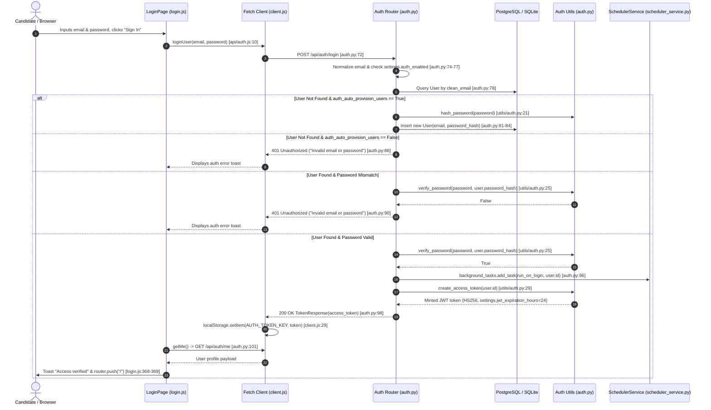
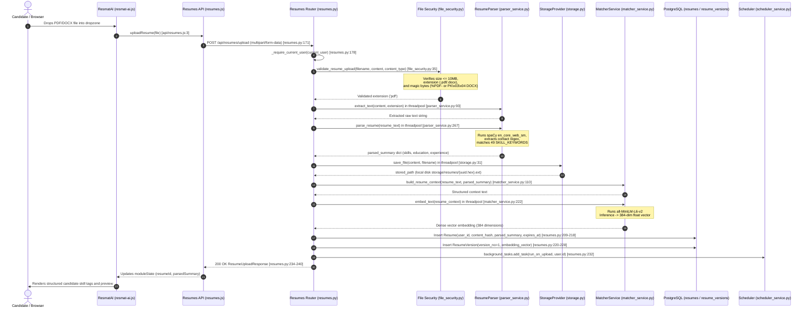
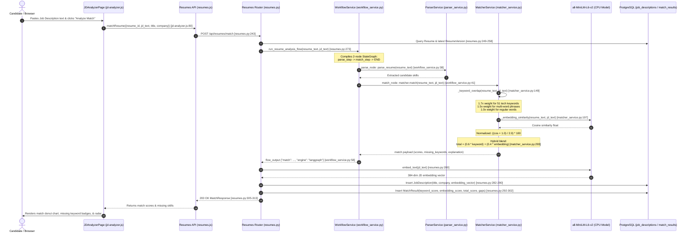
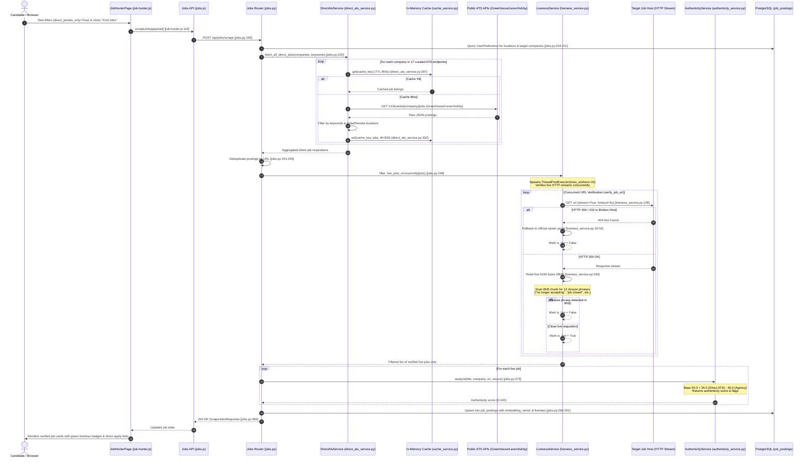

# ClearHire.AI — End-to-End Architectural Flows

> **Target Audience**: Final-year Computer Science / AI-ML engineering student onboarding onto the codebase.  
> **Source-of-Truth**: Every step is traced directly through source code from frontend user action to database/model execution, citing relative file paths and line ranges.

---

## 1. Executive Summary of Core System Flows

ClearHire.AI connects modern React/Next.js user workflows with high-performance FastAPI asynchronous processing, deterministic NLP pipelines, dense vector similarity computations, and external ATS network integrations.

This document traces the four critical architectural flows through the system:
1. **Candidate Authentication & Session Provisioning**: Secure credential verification, auto-provision gating, JWT generation, and scheduler background synchronization.
2. **Resume Ingestion, Security Auditing, Deterministic Parsing & Vectorization**: Magic-byte inspection, spaCy entity extraction, storage abstraction, and 384-dimensional dense semantic embedding.
3. **60/40 Hybrid JD Matching & LangGraph StateGraph Execution**: 2-node linear state machine chaining deterministic skill parsing with weighted lexical overlap and dense embedding cosine similarity.
4. **First-Party ATS Sourcing, Concurrent Liveness Auditing & Authenticity Scoring**: Greenhouse/Lever/Ashby API querying, multi-threaded 8KB stream closure phrase detection, and recruiter authenticity scoring.

---

## 2. Flow 1: Candidate Authentication (Login) & Session Provisioning

### Sequence Diagram

### Step-by-Step Code Walkthrough

1. **User Action**: The candidate enters credentials on the login screen and submits the form ([frontend/src/pages/login.js:347-375](../frontend/src/pages/login.js#L347-L375); dispatches `loginUser` at line 361).
2. **Frontend Dispatch**: `LoginPage` calls `loginUser(email, password)` ([frontend/src/api/auth.js:10-30](../frontend/src/api/auth.js#L10-L30)), which issues an HTTP POST request via the centralized `request()` function ([frontend/src/api/client.js:66-116](../frontend/src/api/client.js#L66-L116)).
3. **Gateway Ingress**: The request hits `POST /api/auth/login` handled by `login()` in [backend/app/api/auth.py:72-99](../backend/app/api/auth.py#L72-L99).
4. **Configuration Check**: The endpoint verifies `settings.auth_enabled` ([config.py:34](../backend/app/utils/config.py#L34)). If auth is disabled, it returns 400 Bad Request ([auth.py:75](../backend/app/api/auth.py#L75)).
5. **Database User Lookup**: The endpoint normalizes `request.email.strip().lower()` and executes `db.query(User).filter(User.email == clean_email).first()` ([auth.py:77-78](../backend/app/api/auth.py#L77-L78)).
6. **Authentication & Auto-Provision Logic**:
   - If user does not exist: Checks `if getattr(settings, "auth_auto_provision_users", False)` ([config.py:35](../backend/app/utils/config.py#L35)). If `False` (default), raises `HTTPException(401, detail="Invalid email or password")` ([auth.py:86-89](../backend/app/api/auth.py#L86-L89)). If `True`, hashes the password with passlib bcrypt ([backend/app/utils/auth.py:21-22](../backend/app/utils/auth.py#L21-L22)), inserts a new `User` record, and commits ([auth.py:81-84](../backend/app/api/auth.py#L81-L84)).
   - If user exists: Calls `verify_password(request.password, user.password_hash)` ([backend/app/utils/auth.py:25-26](../backend/app/utils/auth.py#L25-L26)). If verification fails, immediately raises `HTTPException(401, detail="Invalid email or password")` without modifying the hash ([auth.py:90-94](../backend/app/api/auth.py#L90-L94)).
7. **Asynchronous Background Hook**: If valid, registers a FastAPI background task `background_tasks.add_task(run_on_login, user.id)` ([auth.py:96](../backend/app/api/auth.py#L96)), triggering `run_on_login` in [backend/app/services/scheduler_service.py:100-109](../backend/app/services/scheduler_service.py#L100-L109) to run automated job sweeps if enabled in candidate preferences.
8. **Token Minting**: `create_access_token(user.id)` in [backend/app/utils/auth.py:29-32](../backend/app/utils/auth.py#L29-L32) creates an HS256 JWT encoding `sub: str(user_id)` and `exp: datetime.utcnow() + timedelta(hours=settings.jwt_expiration_hours)` (24 hours at [config.py:33](../backend/app/utils/config.py#L33)).
9. **Client Storage & Redirection**:
   - The browser receives `TokenResponse(access_token=token)` ([auth.py:98](../backend/app/api/auth.py#L98)).
   - The frontend invokes `setAuthToken(tokenPayload.access_token)` ([frontend/src/api/client.js:22-33](../frontend/src/api/client.js#L22-L33)), writing the token into `localStorage.setItem(AUTH_TOKEN_KEY, token)` (`AUTH_TOKEN_KEY = "clearhire_access_token"` at line 29).
   - `LoginPage` calls `await getMe()` ([frontend/src/api/auth.js:68-70](../frontend/src/api/auth.js#L68-L70)), fetching current profile details via `GET /api/auth/me` ([auth.py:101](../backend/app/api/auth.py#L101)).
   - The client navigates to the primary workspace view via `router.push("/")` ([login.js:369](../frontend/src/pages/login.js#L369)).

---

## 3. Flow 2: Resume Ingestion, Security Auditing & Deterministic Parsing

### Sequence Diagram

### Step-by-Step Code Walkthrough

1. **Upload Trigger**: The candidate drops or selects a resume file on `ResmatPage` ([frontend/src/pages/resmat-ai.js:77-105](../frontend/src/pages/resmat-ai.js#L77-L105); dispatches `uploadResume(file)` at line 87).
2. **Multipart Construction**: `uploadResume(file)` appends the binary file to `FormData` and posts to `/api/resumes/upload` ([frontend/src/api/resumes.js:3-11](../frontend/src/api/resumes.js#L3-L11)).
3. **Ownership Guard**: In [backend/app/api/resumes.py:178](../backend/app/api/resumes.py#L178), `_require_current_user(current_user)` ensures the request contains a valid Bearer token if `settings.auth_enabled` is active.
4. **Magic Byte Security Validation**: `validate_resume_upload` in [backend/app/utils/file_security.py:35-67](../backend/app/utils/file_security.py#L35-L67):
   - Enforces byte length $\le 10 \text{ MB}$ (`settings.max_upload_mb` = 10 at [config.py:38](../backend/app/utils/config.py#L38)).
   - Checks file extension against `{"pdf", "docx"}` ([config.py:36](../backend/app/utils/config.py#L36)).
   - Inspects real file headers: verifies `b"%PDF-"` magic header for PDF ([line 15](../backend/app/utils/file_security.py#L15)), or valid zip container with `[Content_Types].xml` and `word/document.xml` while rejecting `word/vbaProject.bin` for DOCX ([lines 18-32](../backend/app/utils/file_security.py#L18-L32)). Rejects spoofed content types with `FileValidationError`.
5. **Text Extraction in Threadpool**: `parser_service.extract_text(content, extension)` in [backend/app/services/parser_service.py:93-181](../backend/app/services/parser_service.py#L93-L181) is offloaded to a worker thread via `run_in_threadpool`:
   - For PDF: Instantiates `PyPDF2.PdfReader(BytesIO(content))` and extracts text page by page (both standard and layout modes), falling back to `pdfminer.high_level` if available.
   - For DOCX: Loads `docx.Document(BytesIO(content))` and extracts paragraph and table cell text.
   - Normalizes text: replaces null bytes `\x00` and cleans non-printable Unicode characters ([lines 184-205](../backend/app/services/parser_service.py#L184-L205)).
6. **Deterministic NLP Parsing**: `parser_service.parse_resume(resume_text)` in [backend/app/services/parser_service.py:267-315](../backend/app/services/parser_service.py#L267-L315):
   - Executes spaCy `en_core_web_sm` to detect named entities (candidate name candidates, organizations).
   - Runs deterministic regex patterns for email (`\b[A-Za-z0-9._%+-]+@[A-Za-z0-9.-]+\.[A-Z|a-z]{2,}\b`) and phone numbers.
   - Matches candidate skills against the 49 `SKILL_KEYWORDS` defined in [backend/app/services/parser_service.py:14-21](../backend/app/services/parser_service.py#L14-L21) (distinct from the 51 `TECH_KEYWORDS` in `matcher_service.py:63-70`).
   - Segments text into structured dictionaries for education, experience, and contact details.
7. **Storage Persistence**: `storage.save_file(content, filename)` in [backend/app/services/storage.py:31-36](../backend/app/services/storage.py#L31-L36) computes a UUID prefix and saves the raw file to `backend/storage/resumes/<uuid.hex><ext>` (or dispatches to S3 via Boto3 if configured at [lines 83-87](../backend/app/services/storage.py#L83-L87)).
8. **Dense Vector Embedding**:
   - Formats a structured text summary via `matcher_service.build_resume_context(...)` ([backend/app/services/matcher_service.py:110-129](../backend/app/services/matcher_service.py#L110-L129)).
   - Passes context to `matcher_service.embed_text(resume_context)` in [backend/app/services/matcher_service.py:222-249](../backend/app/services/matcher_service.py#L222-L249).
   - Generates a 384-dimensional dense vector using `SentenceTransformer("all-MiniLM-L6-v2")` running locally on CPU.
9. **Relational & Vector Storage**:
   - Inserts a record into the `resumes` table ([backend/app/models/resume.py:16-29](../backend/app/models/resume.py#L16-L29)) with SHA256 content hash, `parsed_summary` JSON, and `expires_at` set according to `settings.resume_retention_days` (15 days at [config.py:53](../backend/app/utils/config.py#L53)).
   - Flushes to generate `resume.id`, then inserts `ResumeVersion` (version 1) ([models/resume.py:32-46](../backend/app/models/resume.py#L32-L46)) storing `content_text`, `embedding` (JSON serialization), and `embedding_vector` (`VectorType` mapped to `pgvector` on PostgreSQL).
   - Commits transaction ([resumes.py:228](../backend/app/api/resumes.py#L228)).
10. **Background Automation**: If authenticated, schedules `background_tasks.add_task(run_on_upload, current_user.id)` ([resumes.py:232](../backend/app/api/resumes.py#L232)), triggering automated job matching against new skills.
11. **UI Synchronization**: Returns `ResumeUploadResponse` ([resumes.py:234-240](../backend/app/api/resumes.py#L234-L240)). The frontend updates `moduleState.js` ([frontend/src/lib/moduleState.js](../frontend/src/lib/moduleState.js)), rendering extracted skill pills, contact details, and activating the downstream JD Analyzer module.

---

## 4. Flow 3: 60/40 Hybrid JD Matching & LangGraph Orchestration Pipeline

### Sequence Diagram

### Step-by-Step Code Walkthrough

1. **Trigger & Payload**: The candidate pastes a target requisition into `JDAnalyzerPage` and triggers analysis ([frontend/src/pages/jd-analyzer.js:79-85](../frontend/src/pages/jd-analyzer.js#L79-L85)). The frontend invokes `matchResume` ([frontend/src/api/resumes.js:13-19](../frontend/src/api/resumes.js#L13-L19)) submitting `resume_id`, `jd_text`, `title`, and `company`.
2. **Endpoint Validation**: Handled by `match_resume` in [backend/app/api/resumes.py:243-315](../backend/app/api/resumes.py#L243-L315):
   - Confirms resume existence and ownership ([resumes.py:249-252](../backend/app/api/resumes.py#L249-L252)).
   - Fetches the latest `ResumeVersion` record ordered by `version_no.desc()` ([resumes.py:254-258](../backend/app/api/resumes.py#L254-L258)).
3. **LangGraph StateGraph Execution**: `run_resume_analysis_flow` in [backend/app/services/workflow_service.py:30-60](../backend/app/services/workflow_service.py#L30-L60):
   - Dynamically imports `StateGraph` and `END` from `langgraph.graph` ([workflow_service.py:16-18](../backend/app/services/workflow_service.py#L16-L18)).
   - Defines `ResumeAnalysisState(TypedDict)` containing `resume_text`, `jd_text`, `parsed`, and `match` ([workflow_service.py:23-28](../backend/app/services/workflow_service.py#L23-L28)).
   - Adds Node 1: `parse_node` invoking `parser.parse_resume(state["resume_text"])` ([workflow_service.py:38-39](../backend/app/services/workflow_service.py#L38-L39)).
   - Adds Node 2: `match_node` invoking `matcher.match(state["resume_text"], state["jd_text"], parsed_summary=state.get("parsed"))` ([workflow_service.py:41-48](../backend/app/services/workflow_service.py#L41-L48)).
   - Wires the linear topology: `parse_step` $\to$ `match_step` $\to$ `END` ([workflow_service.py:53-55](../backend/app/services/workflow_service.py#L53-L55)).
   - Compiles and invokes: `app = graph.compile(); result = app.invoke(...)` returning `{"engine": "langgraph"}` ([workflow_service.py:57-59](../backend/app/services/workflow_service.py#L57-L59)).
   - *Fallback*: If LangGraph is uninstalled or fails, lines 33–36 execute the deterministic pipeline directly with `engine: "service-pipeline"`.
4. **Custom Weighted Lexical Matching**: Executed in `_keyword_overlap` ([backend/app/services/matcher_service.py:149-195](../backend/app/services/matcher_service.py#L149-L195)):
   - Extracts required tokens from the JD text (`_extract_requirement_terms`).
   - Applies discrete weight multipliers:
     - Curated Tech Keywords (51 terms in [matcher_service.py:63-70](../backend/app/services/matcher_service.py#L63-L70)) receive **1.7x** ([line 167](../backend/app/services/matcher_service.py#L167)).
     - Multi-word compound phrases containing spaces, slashes, or pluses (e.g. `CI/CD`, `Next.js`) receive **1.5x** ([line 169](../backend/app/services/matcher_service.py#L169)).
     - Standard words receive **1.0x** ([line 170](../backend/app/services/matcher_service.py#L170)).
   - Computes:
     $$\text{keyword\_score} = \left(\frac{\sum w_{\text{matched}}}{\max(1.0, \sum w_{\text{required}})}\right) \times 100$$
   - Gathers list of `missing_keywords` required by the JD but absent from the resume.
5. **Dense Embedding Cosine Similarity**: In `_embedding_similarity` ([backend/app/services/matcher_service.py:197-205](../backend/app/services/matcher_service.py#L197-L205)):
   - Encodes resume text and JD text into 384-dimensional dense vectors with `all-MiniLM-L6-v2`.
   - Normalizes raw cosine similarity to a 0–100 scale:
     $$\text{embedding\_score} = \text{round}\left(\frac{\text{similarity} + 1.0}{2.0} \times 100, 2\right)$$
6. **Hybrid Blend**: Blends scores according to the strict 60/40 rule ([matcher_service.py:293](../backend/app/services/matcher_service.py#L293)):
   $$\text{total\_score} = \text{round}((0.6 \times \text{keyword\_score}) + (0.4 \times \text{embedding\_score}), 2)$$
7. **Database Persistence**:
   - Embeds the JD text to populate `embedding_vector` on `JobDescription` ([resumes.py:280, 287](../backend/app/api/resumes.py#L280)).
   - Inserts `JobDescription` record into `job_descriptions` ([resumes.py:282-290](../backend/app/api/resumes.py#L282-L290)).
   - Inserts `MatchResult` into `match_results` ([resumes.py:292-303](../backend/app/api/resumes.py#L292-L303)) storing scores, gaps, and explanation metadata.
8. **Client Rendering**: Returns `MatchResponse` ([resumes.py:305-313](../backend/app/api/resumes.py#L305-L313)). `JDAnalyzerPage` updates component state ([jd-analyzer.js:120](../frontend/src/pages/jd-analyzer.js#L120)), rendering the match percentage donut, score breakdown, missing skill badges, and market signals.

---

## 5. Flow 4: Job Scrape, First-Party ATS Sourcing & Liveness Auditing

### Sequence Diagram

### Step-by-Step Code Walkthrough

1. **User Action**: The candidate configures job filters (e.g. `direct_portals_only: true`, `exclude_staffing_agencies: true`) and triggers a search on `JobHunterPage` ([frontend/src/pages/job-hunter.js:118-128](../frontend/src/pages/job-hunter.js#L118-L128)).
2. **API Request**: `scrapeJobs` issues an HTTP POST to `/api/jobs/scrape` ([frontend/src/api/jobs.js:15-20](../frontend/src/api/jobs.js#L15-L20)).
3. **Preference Hydration**: Handled by `scrape_jobs` in [backend/app/api/jobs.py:195-370](../backend/app/api/jobs.py#L195-L370). It loads the candidate's `UserPreference` record to retrieve preferred locations, target companies, and maximum posting age ([jobs.py:204-211](../backend/app/api/jobs.py#L204-L211)).
4. **First-Party Direct ATS Ingestion**: In [backend/app/services/direct_ats_service.py:269-336](../backend/app/services/direct_ats_service.py#L269-L336):
   - Iterates through the `CURATED_ATS_REGISTRY` of 17 tech leaders ([direct_ats_service.py:60-80](../backend/app/services/direct_ats_service.py#L60-L80)) including Postman, InMobi, Stripe, Replit, and Coinbase.
   - Computes a hash cache key and checks the in-memory `CacheService` ([cache_service.py:12](../backend/app/services/cache_service.py#L12)) with a 900-second (15-minute) TTL ([direct_ats_service.py:332](../backend/app/services/direct_ats_service.py#L332)).
   - On cache miss, queries official public ATS endpoints:
     - Greenhouse: `https://boards-api.greenhouse.io/v1/boards/{board_token}/jobs?content=true`
     - Lever: `https://api.lever.co/v0/postings/{site}?mode=json`
     - Ashby: `https://api.ashbyhq.com/posting-api/job-board/{board_name}`
   - Filters by India/Remote location keywords ([direct_ats_service.py:82](../backend/app/services/direct_ats_service.py#L82)) and target skill keywords.
5. **Deduplication**: Job postings are deduplicated by target URL ([jobs.py:241-245](../backend/app/api/jobs.py#L241-L245)).
6. **Concurrent Liveness Auditing**: `filter_live_jobs_concurrently(jobs)` in [backend/app/services/liveness_service.py:210-245](../backend/app/services/liveness_service.py#L210-L245):
   - Instantiates a `ThreadPoolExecutor(max_workers=10)` ([liveness_service.py:237](../backend/app/services/liveness_service.py#L237)).
   - Concurrently executes `verify_job_url(job.url)` for each requisition ([liveness_service.py:99-207](../backend/app/services/liveness_service.py#L99-L207)):
     - Dispatches a streaming HTTP GET: `requests.get(url, stream=True, timeout=5.0)` ([liveness_service.py:128](../backend/app/services/liveness_service.py#L128)).
     - If the server returns HTTP 404 (Not Found), 410 (Gone), or connection error, marks `is_live = False` and substitutes a verified corporate fallback URL from `COMPANY_CAREER_PORTALS` (34 portals at [liveness_service.py:19-54](../backend/app/services/liveness_service.py#L19-L54)).
     - If HTTP 200 OK, reads an initial chunk of exactly **8192 bytes (8KB)** from the raw stream ([liveness_service.py:159](../backend/app/services/liveness_service.py#L159)).
     - Scans the 8KB byte chunk against **12 closure keywords** ([liveness_service.py:56-69](../backend/app/services/liveness_service.py#L56-L69)): `"no longer accepting applications"`, `"this job has expired"`, `"position has been closed"`, `"requisition closed"`, etc.
     - If any closure phrase is detected, immediately flags the requisition as closed and dead.
   - Filters the candidate list, dropping all unconfirmed or closed requisitions.
7. **Authenticity Scoring**: In [backend/app/services/authenticity_service.py:157-268](../backend/app/services/authenticity_service.py#L157-L268):
   - Starts at a neutral baseline of **50.0 points** ([line 173](../backend/app/services/authenticity_service.py#L173)).
   - Awards **+35.0 points** for verified first-party ATS origins (Greenhouse, Lever, Ashby) ([line 179](../backend/app/services/authenticity_service.py#L179)).
   - Awards **+25.0 points** for verified direct company career portals ([line 182](../backend/app/services/authenticity_service.py#L182)).
   - Deducts **-40.0 points** if known staffing agency phrases are detected in title or company name ([line 193](../backend/app/services/authenticity_service.py#L193)).
8. **Vector Embedding & Upsert**:
   - Computes dense vector embeddings for all scraped job descriptions in batch using `matcher.embed_texts_batch` ([jobs.py:272](../backend/app/api/jobs.py#L272)).
   - Upserts into the `job_postings` table ([backend/app/models/jobs.py:15-40](../backend/app/models/jobs.py#L15-L40)) with `embedding_vector` (`VectorType`), authenticity metadata, and `scraped_at = datetime.utcnow()` ([jobs.py:284-301](../backend/app/api/jobs.py#L284-L301)).
9. **UI Display & Direct ATS Routing**: The API returns `ScrapeJobsResponse` ([jobs.py:365](../backend/app/api/jobs.py#L365)). `JobHunterPage` receives verified postings ([job-hunter.js:130-135](../frontend/src/pages/job-hunter.js#L130-L135)) and renders live job cards equipped with authenticity score badges, ghosting risk flags, match donuts, and 1-click verified application links.

---

## 6. Comprehensive File and Line Reference Table

The table below reconciles every code reference cited across all four end-to-end flows:

| Flow Stage | Subsystem | File Path | Cited Line Range | Concrete Purpose & Implementation Detail |
|---|---|---|---|---|
| **1. Login** | Frontend UI | `frontend/src/pages/login.js` | [Lines 347–375](../frontend/src/pages/login.js#L347-L375) | Form submission handler calling `loginUser()` (line 361), storing token, and routing to `/`. |
| **1. Login** | API Client | `frontend/src/api/auth.js` | [Lines 10–30](../frontend/src/api/auth.js#L10-L30) | Issues POST to `/api/auth/login`. |
| **1. Login** | Token Storage | `frontend/src/api/client.js` | [Lines 22–33, 29](../frontend/src/api/client.js#L22-L33) | Persists JWT token into `localStorage` (`clearhire_access_token` at line 29). |
| **1. Login** | Gateway Router | `backend/app/api/auth.py` | [Lines 72–99](../backend/app/api/auth.py#L72-L99) | `login()` endpoint: auto-provision check, password verify, and JWT minting. |
| **1. Login** | Config Gate | `backend/app/utils/config.py` | [Lines 34–35](../backend/app/utils/config.py#L34-L35) | `auth_enabled: bool = True`, `auth_auto_provision_users: bool = False`. |
| **1. Login** | Password Hashing | `backend/app/utils/auth.py` | [Lines 21, 25, 29](../backend/app/utils/auth.py#L21) | `hash_password()`, `verify_password()`, and `create_access_token()`. |
| **1. Login** | Background Hook | `backend/app/services/scheduler_service.py` | [Lines 100–109](../backend/app/services/scheduler_service.py#L100-L109) | `run_on_login(user_id)` triggers automated job scraping pass. |
| **2. Resume Upload** | Frontend UI | `frontend/src/pages/resmat-ai.js` | [Lines 77–105](../frontend/src/pages/resmat-ai.js#L77-L105) | File dropzone event handler calling `uploadResume(file)` at line 87. |
| **2. Resume Upload** | API Client | `frontend/src/api/resumes.js` | [Lines 3–11](../frontend/src/api/resumes.js#L3-L11) | Constructs `FormData` and issues POST to `/api/resumes/upload`. |
| **2. Resume Upload** | Gateway Router | `backend/app/api/resumes.py` | [Lines 171–240](../backend/app/api/resumes.py#L171-L240) | `upload_resume()` endpoint: security validation, text extraction, and vectorization. |
| **2. Resume Upload** | File Security | `backend/app/utils/file_security.py` | [Lines 35–67](../backend/app/utils/file_security.py#L35-L67) | `validate_resume_upload()` verifies magic bytes (`%PDF-`, `PK\x03\x04`) and 10MB limit. |
| **2. Resume Upload** | Text Extraction | `backend/app/services/parser_service.py` | [Lines 93–181](../backend/app/services/parser_service.py#L93-L181) | `extract_text()` using PyPDF2, pdfminer, and python-docx in threadpool. |
| **2. Resume Upload** | NLP Parsing | `backend/app/services/parser_service.py` | [Lines 267–315](../backend/app/services/parser_service.py#L267-L315) | `parse_resume()` using spaCy `en_core_web_sm` and 49 `SKILL_KEYWORDS` ([lines 14–21](../backend/app/services/parser_service.py#L14-L21)). |
| **2. Resume Upload** | Disk Storage | `backend/app/services/storage.py` | [Lines 31–36, 83–87](../backend/app/services/storage.py#L31-L36) | `save_file()` writing raw file to `storage/resumes/<uuid.hex><ext>`. |
| **2. Resume Upload** | Dense Embedding | `backend/app/services/matcher_service.py` | [Lines 222–249](../backend/app/services/matcher_service.py#L222-L249) | `embed_text()` running `all-MiniLM-L6-v2` generating 384-dimensional dense vector. |
| **2. Resume Upload** | Database Models | `backend/app/models/resume.py` | [Lines 16–46](../backend/app/models/resume.py#L16-L46) | `Resume` (15-day retention default) and `ResumeVersion` (`VectorType` embedding). |
| **3. JD Matching** | Frontend UI | `frontend/src/pages/jd-analyzer.js` | [Lines 79–85](../frontend/src/pages/jd-analyzer.js#L79-L85) | `matchResume()` trigger passing resume ID and target JD text. |
| **3. JD Matching** | Gateway Router | `backend/app/api/resumes.py` | [Lines 243–315](../backend/app/api/resumes.py#L243-L315) | `match_resume()` endpoint coordinating LangGraph analysis flow. |
| **3. JD Matching** | LangGraph Pipeline | `backend/app/services/workflow_service.py` | [Lines 30–60](../backend/app/services/workflow_service.py#L30-L60) | 2-node linear `StateGraph` (`parse_step` $\to$ `match_step` $\to$ `END`). |
| **3. JD Matching** | Weighted Lexical | `backend/app/services/matcher_service.py` | [Lines 149–195](../backend/app/services/matcher_service.py#L149-L195) | `_keyword_overlap()` applying 1.7x tech (51 `TECH_KEYWORDS` at [lines 63–70](../backend/app/services/matcher_service.py#L63-L70)), 1.5x phrases, 1.0x regular weights. |
| **3. JD Matching** | Cosine Norm | `backend/app/services/matcher_service.py` | [Lines 197–205](../backend/app/services/matcher_service.py#L197-L205) | `_embedding_similarity()` normalizing cosine distance to 0–100 scale. |
| **3. JD Matching** | Hybrid Formula | `backend/app/services/matcher_service.py` | [Line 293](../backend/app/services/matcher_service.py#L293) | Final score blend: `round((0.6 * keyword) + (0.4 * embedding), 2)`. |
| **4. Job Scraping** | Frontend UI | `frontend/src/pages/job-hunter.js` | [Lines 118–128](../frontend/src/pages/job-hunter.js#L118-L128) | Search trigger passing direct portals and location filter flags. |
| **4. Job Scraping** | Gateway Router | `backend/app/api/jobs.py` | [Lines 195–370](../backend/app/api/jobs.py#L195-L370) | `scrape_jobs()` endpoint orchestrating direct ATS, liveness, and authenticity. |
| **4. Job Scraping** | First-Party ATS | `backend/app/services/direct_ats_service.py` | [Lines 60–80, 269–336](../backend/app/services/direct_ats_service.py#L60-L80) | `CURATED_ATS_REGISTRY` (17 tech companies) querying Greenhouse/Lever/Ashby via `fetch_all_direct_jobs`. |
| **4. Job Scraping** | ATS Cache | `backend/app/services/direct_ats_service.py` | [Line 332](../backend/app/services/direct_ats_service.py#L332) | In-memory cache TTL: 900 seconds (15 minutes). |
| **4. Job Scraping** | Liveness Stream | `backend/app/services/liveness_service.py` | [Lines 128, 159, 210–245](../backend/app/services/liveness_service.py#L128) | Concurrent 8KB HTTP stream sampling in `ThreadPoolExecutor(max_workers=10)` (line 237). |
| **4. Job Scraping** | Closure Keywords | `backend/app/services/liveness_service.py` | [Lines 56–69](../backend/app/services/liveness_service.py#L56-L69) | 12 closure phrases scanned in the first 8192 bytes. |
| **4. Job Scraping** | Fallback Portals | `backend/app/services/liveness_service.py` | [Lines 19–54](../backend/app/services/liveness_service.py#L19-L54) | 34 official company career portals used when specific postings close. |
| **4. Job Scraping** | Authenticity | `backend/app/services/authenticity_service.py` | [Lines 157–268](../backend/app/services/authenticity_service.py#L157-L268) | Base 50.0 rating + 35.0 (Direct ATS) - 40.0 (Staffing agency penalty). |
| **4. Job Scraping** | Vector DB | `backend/app/models/jobs.py` | [Lines 15–40](../backend/app/models/jobs.py#L15-L40) | `JobPosting` model with `embedding_vector` (`VectorType`) and authenticity tags. |
