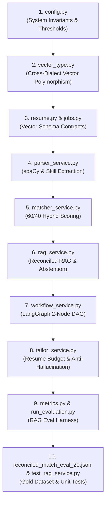
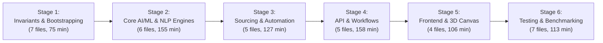

# ClearHire.AI — Codebase Reading Guide & Sequential Onboarding Path

> **Target Audience**: Final-year Computer Science / AI-ML engineering student onboarding onto the codebase.  
> **Source-of-Truth**: Every file path, line range, class name, function name, and architectural invariant is verified directly against the live repository source code. All paths are relative.

---

## 1. Executive Onboarding Strategy

Entering a multi-tiered production AI engineering repository can be overwhelming if approached haphazardly. In academia and introductory ML courses, machine learning often appears confined to Jupyter notebooks: loading a CSV, calling `model.fit()`, and printing an F1 score. 

In production, **machine learning models do not exist in isolation**. A robust AI platform must solve:
1. **Data Invariants & Type Contracts**: Ensuring strict database schemas, vector column polymorphism, and defensive configuration bootstrapping before any model touches data.
2. **Deterministic Preprocessing & Hybrid Scoring**: Pairing dense semantic vectors (`all-MiniLM-L6-v2`) with weighted lexical overlap to catch exact keywords that embeddings gloss over.
3. **Evidence Reconciliation & Hallucination Guardrails**: Refusing to generate LLM recommendations unless mathematically supported by multi-source evidence (the Reconciled RAG pattern).
4. **Physical World Constraints**: Programmatically calculating point-geometry and word budgets so tailored resumes physically fit on a single page.
5. **Real-World Network Reliability**: Ingesting authoritative direct ATS endpoints and inspecting HTTP streaming chunks (8KB) to filter out expired requisitions and phantom "ghost jobs".
6. **Finite State Auditing**: Enforcing state transitions and human confirmation barriers before dispatching job applications.

To master this architecture rapidly, you must read the codebase **in order of dependency and data flow**, moving from foundational system invariants up to higher-order AI pipelines, APIs, UI rendering, and offline evaluation harnesses.

---

## 2. Reading Tracks & Time Estimates

ClearHire.AI provides two tailored reading tracks depending on your immediate onboarding objective:

| Track | Target Persona | Focus Areas | Total Entries | Total Files | Total Lines | Est. Reading Time |
|---|---|---|---|---|---|---|
| **Fast Track** | AI / ML Engineering Specialist | Core NLP, Embeddings, Reconciled RAG, State Graphs, Metrics & Benchmarks | 10 steps | 13 files | 3,020 lines | **225 min (~3.75 hours)** |
| **Full Track** | Full-Stack AI Engineer / Tech Lead | Complete system architecture: Config, DB, ML, Scrapers, APIs, WebGL, Tests | 31 steps | 34 files | 10,341 lines | **734 min (~12.2 hours)** |

### Reading Velocity Baseline
Reading estimates are calculated based on code density:
- **High-Density Algorithmic & ML Code** (e.g., `matcher_service.py`, `rag_service.py`, `metrics.py`): ~10–12 lines/minute (requires tracing equations, edge cases, and fallbacks).
- **Medium-Density API & Service Code** (e.g., `resumes.py`, `applications.py`, `liveness_service.py`): ~15–20 lines/minute.
- **Low-Density Boilerplate & Models** (e.g., `user.py`, `database.py`, Pydantic schemas): ~25–35 lines/minute.

---

## 3. Fast Track: 4-Hour AI/ML Core Path (225 Minutes)

If your immediate goal is to understand the AI/ML architecture, embedding pipelines, RAG reconciliation algorithms, and evaluation benchmarks, follow this strict 10-step sequence:

### Fast Track Reading Order Table

| Step | File Path | Focus Area | Lines | Est. Time |
|---|---|---|---|---|
| **1** | [backend/app/utils/config.py](../backend/app/utils/config.py) | RAG similarity & abstention thresholds, production validation | 173 | 15 min |
| **2** | [backend/app/models/vector_type.py](../backend/app/models/vector_type.py) | pgvector PostgreSQL vs SQLite JSON fallback polymorphism | 43 | 5 min |
| **3** | [backend/app/models/resume.py](../backend/app/models/resume.py) & [jobs.py](../backend/app/models/jobs.py) | 384-dim vector columns, match result entities, and audit fields | 200 | 15 min |
| **4** | [backend/app/services/parser_service.py](../backend/app/services/parser_service.py) | Deterministic PDF/DOCX text extraction, spaCy NLP entity parsing | 702 | 35 min |
| **5** | [backend/app/services/matcher_service.py](../backend/app/services/matcher_service.py) | Non-linear term weighting (1.7x/1.5x/1.0x), 60/40 hybrid score | 310 | 30 min |
| **6** | [backend/app/services/rag_service.py](../backend/app/services/rag_service.py) | Dual-threshold abstention, ambiguity margin, grounded confidence | 566 | 45 min |
| **7** | [backend/app/services/workflow_service.py](../backend/app/services/workflow_service.py) | LangGraph 2-node StateGraph orchestration with sync fallback | 60 | 10 min |
| **8** | [backend/app/services/tailor_service.py](../backend/app/services/tailor_service.py) | 1-page budget (48 lines/620 words), anti-hallucination keyword gating | 215 | 20 min |
| **9** | [backend/app/evaluation/metrics.py](../backend/app/evaluation/metrics.py) & [run_evaluation.py](../backend/app/evaluation/run_evaluation.py) | P95 latency, precision@k, hallucination rate, SQLite memory eval | 265 | 25 min |
| **10** | [backend/app/evaluation/datasets/reconciled_match_eval_20.json](../backend/app/evaluation/datasets/reconciled_match_eval_20.json) & [test_rag_service.py](../backend/tests/test_rag_service.py) | 20 gold evaluation test cases, unit testing of abstention modes | 486 | 25 min |
| **TOTAL** | **13 Files across 10 Steps** | **Complete Core AI/ML Engine & Evaluation Suite** | **3,020** | **225 min (~3.75 hrs)** |

---

## 4. Full Track: Complete Sequential Reading Order (6 Stages, 31 Steps, 34 Files)

For developers building features, maintaining production services, or preparing for system architecture interviews, read the codebase across the 6 complete lifecycle stages:

---

### Stage 1: System Invariants & Bootstrapping (Config, DB, Models)

Before inspecting algorithms, you must understand how ClearHire initializes state, enforces database constraints, and guarantees cross-dialect vector compatibility.

#### 1. [`backend/app/utils/config.py`](../backend/app/utils/config.py)
- **Reading Time**: 15 minutes (173 lines)
- **Prerequisites**: None (Start here).
- **Specific Focus**:
  - Class `Settings` ([lines 12–119](../backend/app/utils/config.py#L12-L119)): Inspect defaults for `database_url`, `embedding_model_name` (`all-MiniLM-L6-v2`), `embedding_dimensions` (`384`), `rag_similarity_threshold` (`0.65`), and `rag_abstain_threshold` (`0.60`).
  - Method `validate_production_requirements` ([lines 121–169](../backend/app/utils/config.py#L121-L169)): Pydantic v2 `@model_validator(mode="after")`. Notice how it catches default/dummy passwords (`job_password_secure`, `postgres`), wildcard CORS (`*`), and insecure origins.
- **Checkpoint**:
  - *Conceptual Milestone*: Configuration is immutable at runtime; invalid settings fail fast at process startup.
  - *Architectural Invariant*: When `environment == "production"`, `debug` must be `False`, `auth_enabled` must be `True`, and CORS must be explicit HTTPS domains.
  - *Gotcha*: `cors_allowed_origins` is stored as a comma-separated string, but split into normalized lowercase origin lists.
- **Why It Was Built This Way**: Eliminates "silent configuration failures" where an engineer accidentally deploys dev credentials or insecure wildcard CORS to production.

#### 2. [`backend/app/database.py`](../backend/app/database.py)
- **Reading Time**: 5 minutes (41 lines)
- **Prerequisites**: [backend/app/utils/config.py](../backend/app/utils/config.py)
- **Specific Focus**:
  - `engine = create_engine(...)` ([lines 9–16](../backend/app/database.py#L9-L16)): Connection pool parameters (`pool_pre_ping=True`, `pool_size=30`, `max_overflow=20`, `pool_timeout=30.0`).
  - Generator `get_db()` ([lines 36–41](../backend/app/database.py#L36-L41)): FastAPI yield-based dependency injection.
- **Checkpoint**:
  - *Conceptual Milestone*: Database session lifecycle management.
  - *Architectural Invariant*: Every HTTP request using `Depends(get_db)` gets an isolated SQLAlchemy session guaranteed to close in the `finally:` block.
  - *Gotcha*: `pool_pre_ping=True` sends a lightweight ping (`SELECT 1`) to detect dropped TCP connections before handing connections to endpoints.
- **Why It Was Built This Way**: Prevents connection pool starvation and handles cloud database restarts without raising 500 errors.

#### 3. [`backend/app/models/vector_type.py`](../backend/app/models/vector_type.py)
- **Reading Time**: 5 minutes (43 lines)
- **Prerequisites**: [backend/app/database.py](../backend/app/database.py)
- **Specific Focus**:
  - Class `EmbeddingVector` ([lines 20–43](../backend/app/models/vector_type.py#L20-L43)): Inherits SQLAlchemy `TypeDecorator`.
  - Methods `load_dialect_impl` ([lines 30–33](../backend/app/models/vector_type.py#L30-L33)), `process_bind_param` ([lines 35–38](../backend/app/models/vector_type.py#L35-L38)), and `process_result_value` ([lines 40–43](../backend/app/models/vector_type.py#L40-L43)).
- **Checkpoint**:
  - *Conceptual Milestone*: Dialect polymorphism in ORM layers.
  - *Architectural Invariant*: On PostgreSQL with `pgvector`, compiles to native `Vector(384)` with hardware SIMD cosine indexing (`<=>`). On SQLite (unit tests / local dev), transparently compiles to `JSON()`.
  - *Gotcha*: Always casts components to `float(component)` during binding and retrieval to avoid serialization type errors.
- **Why It Was Built This Way**: Allows engineers to run complete pytest suites locally on SQLite in under 90 seconds without spinning up a heavy Docker PostgreSQL container.

#### 4. [`backend/app/models/user.py`](../backend/app/models/user.py)
- **Reading Time**: 3 minutes (27 lines)
- **Prerequisites**: [backend/app/database.py](../backend/app/database.py)
- **Specific Focus**:
  - Class `User` ([lines 14–27](../backend/app/models/user.py#L14-L27)): UUID primary keys (`id: Mapped[str] = mapped_column(String(36))`), `email`, `password_hash`.
- **Checkpoint**:
  - *Conceptual Milestone*: Identity boundary entity.
  - *Architectural Invariant*: User identifiers are standard 36-character UUID strings generated via Python's `uuid.uuid4()`.
- **Why It Was Built This Way**: Keeps identity minimal and isolated from candidate artifacts.

#### 5. [`backend/app/models/resume.py`](../backend/app/models/resume.py)
- **Reading Time**: 12 minutes (113 lines)
- **Prerequisites**: [backend/app/models/vector_type.py](../backend/app/models/vector_type.py), [backend/app/models/user.py](../backend/app/models/user.py)
- **Specific Focus**:
  - `Resume` ([lines 16–30](../backend/app/models/resume.py#L16-L30)): `content_hash` (SHA-256 deduplication), `expires_at` (retention policy), cascade relationships.
  - `ResumeVersion` ([lines 32–47](../backend/app/models/resume.py#L32-L47)): `embedding_vector` mapped to `EmbeddingVector(384)`.
  - `JobDescription` ([lines 49–64](../backend/app/models/resume.py#L49-L64)): Embedding vector storage for target JDs.
  - `MatchResult` ([lines 66–89](../backend/app/models/resume.py#L66-L89)): `keyword_score`, `embedding_score`, `total_score`, `reconciliation_status`, and `abstained` flag.
  - `Application` & `ApplicationSubmissionLog` ([lines 91–113](../backend/app/models/resume.py#L91-L113)): Tracks FSM status and audit history.
- **Checkpoint**:
  - *Conceptual Milestone*: Separation of original resume upload from immutable version history and computed match scores.
  - *Architectural Invariant*: Every match attempt records both scores and an explicit boolean `abstained` flag.
- **Why It Was Built This Way**: Prevents destructive edits to the user's base resume and maintains a reproducible audit log of AI evaluations.

#### 6. [`backend/app/models/jobs.py`](../backend/app/models/jobs.py)
- **Reading Time**: 10 minutes (87 lines)
- **Prerequisites**: [backend/app/models/vector_type.py](../backend/app/models/vector_type.py)
- **Specific Focus**:
  - `JobPosting` ([lines 15–41](../backend/app/models/jobs.py#L15-L41)): `source`, `company`, `title`, `url`, `embedding_vector`, `authenticity_score`, `ghosting_risk`, `is_direct_employer`, `is_evergreen`.
  - `UserPreference` ([lines 43–73](../backend/app/models/jobs.py#L43-L73)): Candidate filtering rules (`target_role`, `exclude_staffing_agencies`, `max_ghosting_risk`, `direct_portals_only`).
  - `DigestLog` ([lines 75–87](../backend/app/models/jobs.py#L75-L87)): Multi-channel notification audit trail.
- **Checkpoint**:
  - *Conceptual Milestone*: Rich metadata schema for candidate requisition matching.
  - *Architectural Invariant*: `JobPosting.url` is strictly unique (`unique=True`) to prevent duplicate scraping.
- **Why It Was Built This Way**: Incorporates recruiter authenticity and liveness attributes directly into the relational schema.

#### 7. [`backend/app/main.py`](../backend/app/main.py)
- **Reading Time**: 25 minutes (317 lines)
- **Prerequisites**: [backend/app/utils/config.py](../backend/app/utils/config.py), [backend/app/database.py](../backend/app/database.py)
- **Specific Focus**:
  - Async context manager `lifespan` ([lines 89–98](../backend/app/main.py#L89-L98)): Launches `start_scheduler()` and gracefully invokes `stop_scheduler()` on SIGTERM.
  - CORS middleware ([lines 109–123](../backend/app/main.py#L109-L123)): Binds allowed origins.
  - Custom middleware `request_context_middleware` ([lines 128–151](../backend/app/main.py#L128-L151)): Assigns UUID `x-request-id`, records process time in milliseconds, logs structured JSON, and increments Prometheus counters.
  - Health checks `/health` ([line 238](../backend/app/main.py#L238)) and `/ready` ([line 251](../backend/app/main.py#L251)): Threadpool execution of `is_database_available()`.
  - Router mounting ([lines 293–301](../backend/app/main.py#L293-L301)): `/api/auth`, `/api/jobs`, `/api/resumes`, `/api/applications`, `/api/digest`, `/api/public`, `/api/analytics`.
- **Checkpoint**:
  - *Conceptual Milestone*: ASGI root bootstrapping and distributed tracing header propagation.
  - *Architectural Invariant*: Every response returns `X-Request-ID` and `X-Process-Time-MS` headers.
- **Why It Was Built This Way**: Centralizes observability, structured JSON logging, and graceful startup/shutdown.

---

### Stage 2: Core AI/ML & NLP Engines (Parser, Matcher, RAG)

Now dive into the computational core of ClearHire: NLP entity extraction, dense semantic vector encoding, hybrid matching formulas, and RAG truth reconciliation.

#### 8. [`backend/app/services/parser_service.py`](../backend/app/services/parser_service.py)
- **Reading Time**: 35 minutes (702 lines)
- **Prerequisites**: [backend/app/models/resume.py](../backend/app/models/resume.py)
- **Specific Focus**:
  - Skill vocabularies & section aliases ([lines 14–82](../backend/app/services/parser_service.py#L14-L82)): Curated sets (`SKILL_KEYWORDS`, `SKILL_SECTION_PREFIXES`, `SECTION_ALIASES`).
  - Class `ResumeParserService` ([line 85](../backend/app/services/parser_service.py#L85)): spaCy initialization (`en_core_web_sm` with fallback to `spacy.blank("en")`).
  - Text extraction `extract_text` ([lines 93–170](../backend/app/services/parser_service.py#L93-L170)): Handles PDF extraction using `PyPDF2` with double extraction (standard stream + layout-aware mode) and encrypted document handling; DOCX extraction using `python-docx`.
  - Core parsing orchestrator `parse_resume` ([lines 267–319](../backend/app/services/parser_service.py#L267-L319)): Segments resume into structured sections (`skills`, `experience`, `projects`, `education`, `certifications`), extracts contact details, and estimates confidence.
  - Confidence estimation `_estimate_parser_confidence` ([lines 525–563](../backend/app/services/parser_service.py#L525-L563)) and skill extraction `_extract_skills` ([lines 565–588](../backend/app/services/parser_service.py#L565-L588)).
- **Checkpoint**:
  - *Conceptual Milestone*: Multi-phase deterministic text extraction prior to token parsing.
  - *Architectural Invariant*: Resumes are parsed into standardized dictionary summaries containing validated skill tokens.
  - *Gotcha*: Layout extraction preserves column positioning in multi-column resumes, preventing contact info from concatenating across columns.
- **Why It Was Built This Way**: Calling an LLM for initial resume text extraction is slow, expensive, and non-deterministic. A tuned spaCy + regex pipeline parses in under 40ms on standard CPUs.

#### 9. [`backend/app/services/matcher_service.py`](../backend/app/services/matcher_service.py)
- **Reading Time**: 30 minutes (310 lines)
- **Prerequisites**: [backend/app/services/parser_service.py](../backend/app/services/parser_service.py)
- **Specific Focus**:
  - Normalization dictionaries `STOPWORDS`, `TOKEN_NORMALIZATION`, and `SKILL_PHRASES` ([lines 12–50](../backend/app/services/matcher_service.py#L12-L50)).
  - Requirement extraction `_extract_requirement_terms` ([lines 149–163](../backend/app/services/matcher_service.py#L149-L163)).
  - Term weighting `_term_weight` ([lines 164–171](../backend/app/services/matcher_service.py#L164-L171)):
    $$\text{Weight}(t) = \begin{cases} 1.7 & \text{if } t \in \text{TECH\_KEYWORDS} \\ 1.5 & \text{if } t \text{ contains } \{' ', '/', '+'\} \\ 1.0 & \text{otherwise} \end{cases}$$
  - Weighted lexical overlap `_keyword_overlap` ([lines 172–195](../backend/app/services/matcher_service.py#L172-L195)): Calculates weighted Jaccard-like score:
    $$\text{Score}_{\text{lex}} = \left( \frac{\sum_{t \in \text{Matched}} w(t)}{\max\left(1.0, \sum_{t \in \text{Required}} w(t)\right)} \right) \times 100$$
  - Dense embedding similarity `_embedding_similarity` & `embed_text` ([lines 197–250](../backend/app/services/matcher_service.py#L197-L250)): `sentence-transformers` `all-MiniLM-L6-v2` with deterministic hash fallback (`_stable_bucket`, `log1p(count)`) if model weights are unavailable.
  - Composite match formula in `match()` ([lines 283–310](../backend/app/services/matcher_service.py#L283-L310)):
    $$\text{Total Score} = \text{round}(0.60 \times \text{Score}_{\text{lex}} + 0.40 \times \text{Score}_{\text{dense}}, 2)$$
- **Checkpoint**:
  - *Conceptual Milestone*: Why pure semantic vector search fails on resumes (e.g. vectors treat "React" and "Angular" as interchangeable frontend tools; the 60% lexical weight prevents false matches).
  - *Architectural Invariant*: Output always returns both sub-scores, `matched_keywords`, `missing_keywords`, and a detailed `explanation` dictionary.
- **Why It Was Built This Way**: Hybrid 60/40 scoring bridges the gap between semantic synonyms and strict recruiter keyword requirements.

#### 10. [`backend/app/services/rag_service.py`](../backend/app/services/rag_service.py)
- **Reading Time**: 45 minutes (566 lines)
- **Prerequisites**: [backend/app/services/matcher_service.py](../backend/app/services/matcher_service.py), [backend/app/models/jobs.py](../backend/app/models/jobs.py)
- **Specific Focus**:
  - Class `ReconciledRAGService` ([line 42](../backend/app/services/rag_service.py#L42)).
  - Multi-source retrieval `retrieve` ([lines 245–259](../backend/app/services/rag_service.py#L245-L259)): Queries `job_postings`, `job_descriptions`, and past `match_results`.
  - Ambiguity detection `_has_conflicting_top_evidence` ([lines 260–297](../backend/app/services/rag_service.py#L260-L297)): Checks if the similarity margin between top 2 candidates is $\le 0.03$ with conflicting company/title metadata.
  - Evidence quality profiling `_evidence_quality` ([lines 299–325](../backend/app/services/rag_service.py#L299-L325)).
  - Reconciliation & Dual-Threshold Abstention in `_reconcile` ([lines 326–435](../backend/app/services/rag_service.py#L326-L435)):
    $$\text{Confidence} = 0.55 \cdot \text{Sim}_{\text{top}} + 0.25 \cdot \left(\frac{\text{Score}_{\text{total}}}{100}\right) + 0.20 \cdot \text{Ratio}_{\text{overlap}} + \text{Bonus}_{\text{title}} - \text{Penalty}_{\text{company}}$$
    - Returns `abstained=True` if $\text{Sim}_{\text{top}} < 0.65$, or if $\text{Ratio}_{\text{overlap}} < \text{MinOverlap}$, or if $\text{Confidence} < 0.60$.
  - Abstention statuses: `"no_match"`, `"ambiguous"`, `"insufficient_skill_evidence"`, `"low_confidence"`, or `"valid"`.
- **Checkpoint**:
  - *Conceptual Milestone*: The Reconciled RAG pattern. AI agents must possess the ability to say "I do not know" or "Insufficient evidence".
  - *Architectural Invariant*: If confidence is below threshold, the service abstains rather than making up a fit narrative.
- **Why It Was Built This Way**: Prevents candidates from receiving misleading AI career recommendations based on hallucinated skill overlap.

#### 11. [`backend/app/services/workflow_service.py`](../backend/app/services/workflow_service.py)
- **Reading Time**: 10 minutes (60 lines)
- **Prerequisites**: [backend/app/services/parser_service.py](../backend/app/services/parser_service.py), [backend/app/services/matcher_service.py](../backend/app/services/matcher_service.py)
- **Specific Focus**:
  - Dynamic loader `_load_langgraph()` ([lines 14–21](../backend/app/services/workflow_service.py#L14-L21)): Graceful import guard.
  - State contract `ResumeAnalysisState` ([lines 23–28](../backend/app/services/workflow_service.py#L23-L28)): Typed dictionary (`resume_text`, `jd_text`, `parsed`, `match`).
  - Graph compilation in `run_resume_analysis_flow` ([lines 30–60](../backend/app/services/workflow_service.py#L30-L60)): 2-node linear DAG:
    $$\text{START} \longrightarrow \text{parse\_step} \longrightarrow \text{match\_step} \longrightarrow \text{END}$$
    Includes a synchronous procedural fallback if LangGraph is uninstalled or fails.
- **Checkpoint**:
  - *Conceptual Milestone*: Decoupling stateful multi-step agent graphs from procedural service code.
  - *Architectural Invariant*: The returned result dictionary always includes an `"engine"` key (`"langgraph"` vs `"service-pipeline"`).
- **Why It Was Built This Way**: Provides an extensible foundation for adding multi-agent human-in-the-loop review nodes without breaking existing service contracts.

#### 12. [`backend/app/services/tailor_service.py`](../backend/app/services/tailor_service.py)
- **Reading Time**: 20 minutes (215 lines)
- **Prerequisites**: [backend/app/services/matcher_service.py](../backend/app/services/matcher_service.py)
- **Specific Focus**:
  - Budget constants ([lines 10–12](../backend/app/services/tailor_service.py#L10-L12)):
    - `MAX_RESUME_LINES = 48`
    - `MAX_RESUME_WORDS = 620`
    - `MAX_BULLET_WORDS = 24`
  - Anti-hallucination keyword gating `_prepare_target_keywords` ([lines 34–58](../backend/app/services/tailor_service.py#L34-L58)): Partitions missing keywords into `supported_keywords` vs `unsupported_keywords`.
- **Checkpoint**:
  - *Conceptual Milestone*: Physical constraint enforcement in generative text workflows.
  - *Architectural Invariant*: Missing keywords not present in the candidate's actual background cannot be injected into experience bullets.
- **Why It Was Built This Way**: Prevents generative AI from fabricating fraudulent candidate experience while ensuring resumes fit on exactly one printed page.

#### 13. [`backend/app/services/pdf_generator_service.py`](../backend/app/services/pdf_generator_service.py)
- **Reading Time**: 15 minutes (148 lines)
- **Prerequisites**: [backend/app/services/tailor_service.py](../backend/app/services/tailor_service.py)
- **Specific Focus**:
  - Class `PdfGeneratorService` ([line 19](../backend/app/services/pdf_generator_service.py#L19)).
  - Point-geometry calculation in `generate_ats_pdf` ([lines 32–70](../backend/app/services/pdf_generator_service.py#L32-L70)): Margins at 36pt (0.5 inch).
  - Dynamic typography adjustment:
    $$\text{base\_font\_size} = \begin{cases} 9.0\text{ pt} & \text{if } \text{line\_count} > 46 \\ 10.0\text{ pt} & \text{otherwise} \end{cases}, \quad \text{leading} = \begin{cases} 11.5\text{ pt} & \text{if } \text{line\_count} > 46 \\ 13.0\text{ pt} & \text{otherwise} \end{cases}$$
- **Checkpoint**:
  - *Conceptual Milestone*: Programmatic headless PDF compilation via ReportLab.
  - *Architectural Invariant*: Output is valid PDF binary bytes generated entirely in memory via `io.BytesIO()`.
- **Why It Was Built This Way**: Browser-based HTML-to-PDF converters (Puppeteer/wkhtmltopdf) frequently introduce unexpected page breaks; ReportLab provides exact mathematical canvas control.

---

### Stage 3: Sourcing, Liveness & Automation (Direct ATS, Liveness, Scheduler)

Discover how ClearHire automates requisition sourcing from first-party ATS board APIs, filters phantom listings, and manages background cron workflows.

#### 14. [`backend/app/services/direct_ats_service.py`](../backend/app/services/direct_ats_service.py)
- **Reading Time**: 30 minutes (358 lines)
- **Prerequisites**: [backend/app/models/jobs.py](../backend/app/models/jobs.py)
- **Specific Focus**:
  - Serialization helpers `_serialize_scraped_job` & `_deserialize_scraped_job` ([lines 23–56](../backend/app/services/direct_ats_service.py#L23-L56)).
  - Curated registry `CURATED_ATS_REGISTRY` ([lines 60–80](../backend/app/services/direct_ats_service.py#L60-L80)): Verified companies mapped to ATS providers (`greenhouse`, `ashby`).
  - Class `DirectAtsService` ([line 100](../backend/app/services/direct_ats_service.py#L100)) and provider adapters:
    - Greenhouse ([lines 125–167](../backend/app/services/direct_ats_service.py#L125-L167)): `https://boards-api.greenhouse.io/v1/boards/{token}/jobs`
    - Lever ([lines 169–208](../backend/app/services/direct_ats_service.py#L169-L208)): `https://api.lever.co/v0/postings/{token}`
    - Ashby ([lines 210–252](../backend/app/services/direct_ats_service.py#L210-L252)): `https://api.ashbyhq.com/posting-api/job-board/{token}`
- **Checkpoint**:
  - *Conceptual Milestone*: First-party ATS board ingestion.
  - *Architectural Invariant*: Scraped listings carry explicit `ats_type` and `source_type="direct_ats"` flags.
- **Why It Was Built This Way**: Scraping aggregator sites triggers Cloudflare bot challenges and yields expired postings; ATS board APIs are public, structured, and authoritative.

#### 15. [`backend/app/services/liveness_service.py`](../backend/app/services/liveness_service.py)
- **Reading Time**: 20 minutes (245 lines)
- **Prerequisites**: [backend/app/services/direct_ats_service.py](../backend/app/services/direct_ats_service.py)
- **Specific Focus**:
  - Known official career portals `COMPANY_CAREER_PORTALS` ([lines 19–54](../backend/app/services/liveness_service.py#L19-L54)): Guaranteed entry points.
  - Expiration keywords `EXPIRED_KEYWORDS` ([lines 56–69](../backend/app/services/liveness_service.py#L56-L69)): Detects strings like `"no longer accepting applications"`, `"this job is closed"`, `"this position has been closed"`.
  - Requisition verification `verify_job_url` ([lines 99–170](../backend/app/services/liveness_service.py#L99-L170)).
  - Zero-download streaming check `sample_bytes = resp.raw.read(8192)` ([lines 159–160](../backend/app/services/liveness_service.py#L159-L160)): Reads only the initial 8KB chunk.
  - Batch screening `filter_live_jobs_concurrently` ([lines 210–245](../backend/app/services/liveness_service.py#L210-L245)): Uses `ThreadPoolExecutor(max_workers=10)` with fast-path bypass for fresh direct ATS postings.
- **Checkpoint**:
  - *Conceptual Milestone*: Bounded HTTP streaming for low-overhead liveness auditing.
  - *Architectural Invariant*: Never downloads megabytes of frontend JS/images to verify a job link; 8KB is sufficient.
- **Why It Was Built This Way**: Checking 100 job URLs sequentially with full HTML downloads would take minutes; streaming 8KB chunks in parallel takes under 3 seconds.

#### 16. [`backend/app/services/authenticity_service.py`](../backend/app/services/authenticity_service.py)
- **Reading Time**: 25 minutes (268 lines)
- **Prerequisites**: [backend/app/services/liveness_service.py](../backend/app/services/liveness_service.py)
- **Specific Focus**:
  - Class `JobAuthenticityService` and method `analyze` ([lines 157–250](../backend/app/services/authenticity_service.py#L157-L250)):
    - Base score: $50.0$
    - Direct ATS board: $+35.0$
    - Staffing agency detection: $-40.0$
    - Freshness: $\le 48\text{ hrs} \implies +15.0$; $\ge 30\text{ days} \implies -25.0$ (marks `is_evergreen=True`)
    - Description depth: $< 120\text{ chars} \implies -15.0$; $> 400\text{ chars} \implies +5.0$
  - Risk categorization: `low` ($\ge 70$ and direct employer), `medium` ($\ge 42$ and not agency), `high` (otherwise).
- **Checkpoint**:
  - *Conceptual Milestone*: Multi-factor heuristic scoring for recruiter authenticity.
  - *Architectural Invariant*: Classifies ghosting risk into discrete bands (`low`, `medium`, `high`).
- **Why It Was Built This Way**: Protects candidates from wasting hours applying to ghost jobs, phantom listings, and third-party staffing agency resume harvesters.

#### 17. [`backend/app/services/scheduler_service.py`](../backend/app/services/scheduler_service.py)
- **Reading Time**: 12 minutes (119 lines)
- **Prerequisites**: [backend/app/main.py](../backend/app/main.py)
- **Specific Focus**:
  - Global `scheduler = BackgroundScheduler(timezone=settings.default_schedule_timezone)` ([line 15](../backend/app/services/scheduler_service.py#L15)).
  - Lifecycle hooks `start_scheduler()` ([lines 33–37](../backend/app/services/scheduler_service.py#L33-L37)) and `stop_scheduler()` ([lines 39–42](../backend/app/services/scheduler_service.py#L39-L42)).
  - Dynamic user cron synchronization `sync_user_schedule()` ([lines 61–92](../backend/app/services/scheduler_service.py#L61-L92)): Registers `CronTrigger` jobs for candidates with automated matching enabled.
  - Automation triggers on candidate events: `run_on_login()` ([lines 100–109](../backend/app/services/scheduler_service.py#L100-L109)) and `run_on_upload()` ([lines 111–119](../backend/app/services/scheduler_service.py#L111-L119)).
- **Checkpoint**:
  - *Conceptual Milestone*: In-process asynchronous task scheduling via APScheduler.
  - *Architectural Invariant*: Runs as a background daemon thread inside the FastAPI process.
- **Why It Was Built This Way**: Eliminates the operational complexity of deploying separate Celery workers and Redis brokers for user-scheduled cron tasks.

#### 18. [`backend/app/services/notification_digest_service.py`](../backend/app/services/notification_digest_service.py)
- **Reading Time**: 40 minutes (567 lines)
- **Prerequisites**: [backend/app/services/scheduler_service.py](../backend/app/services/scheduler_service.py), [backend/app/services/authenticity_service.py](../backend/app/services/authenticity_service.py)
- **Specific Focus**:
  - Dataclasses: `DigestJobItem`, `GhostingActionItem`, and `FunnelMetrics` ([lines 27–64](../backend/app/services/notification_digest_service.py#L27-L64)).
  - Funnel metrics calculation `compute_funnel_analytics()` ([lines 100–172](../backend/app/services/notification_digest_service.py#L100-L172)): Derives conversion rates (screen conversion, interview conversion, offer rate, ghosting rate).
  - Digest generation `build_morning_digest()` ([lines 174–261](../backend/app/services/notification_digest_service.py#L174-L261)): Curates top verified jobs, formats ghosting follow-up alerts.
  - Multi-channel dispatch `dispatch_digest()` ([lines 418–536](../backend/app/services/notification_digest_service.py#L418-L536)):
    - Telegram Bot API via `requests.post` ([lines 430–462](../backend/app/services/notification_digest_service.py#L430-L462)).
    - Twilio WhatsApp API via `requests.post` ([lines 464–497](../backend/app/services/notification_digest_service.py#L464-L497)).
    - SMTP email delivery using inline `smtplib` ([lines 499–534](../backend/app/services/notification_digest_service.py#L499-L534)).
    - Graceful fallback to `status="simulated"` when tokens/credentials are unconfigured.
  - Audit logging `_record_log()` ([lines 538–567](../backend/app/services/notification_digest_service.py#L538-L567)): Persists dispatch history into `DigestLog`.
- **Checkpoint**:
  - *Conceptual Milestone*: Automated multi-channel candidate briefing pipelines.
  - *Architectural Invariant*: Dispatches fall back to `simulated` mode when API keys are absent, ensuring development environments never crash on notification triggers.
- **Why It Was Built This Way**: Delivers curated morning job alerts and follow-up warnings directly to candidates across their preferred messaging apps without third-party SaaS dependencies.

---

### Stage 4: API Gateway & Application Workflows (Auth, Resumes, Jobs, Applications)

Explore how backend services are exposed via FastAPI routers, validated with Pydantic schemas, and guarded by state machines.

#### 19. [`backend/app/utils/auth.py`](../backend/app/utils/auth.py) & [`backend/app/api/auth.py`](../backend/app/api/auth.py)
- **Reading Time**: 23 minutes (234 lines combined: 68 lines in `utils/auth.py`, 166 lines in `api/auth.py`)
- **Prerequisites**: [backend/app/models/user.py](../backend/app/models/user.py)
- **Specific Focus**:
  - Password hashing via `PassLib` bcrypt context and JWT encoding `create_access_token` ([utils/auth.py:20–33](../backend/app/utils/auth.py#L20-L33)).
  - Dependencies `get_current_user_optional` and `get_current_user` ([utils/auth.py:35–68](../backend/app/utils/auth.py#L35-L68)).
  - Endpoints in `api/auth.py`:
    - `POST /api/auth/register` ([lines 42–89](../backend/app/api/auth.py#L42-L89)): Validates email, hashes password, creates `User`.
    - `POST /api/auth/login` ([lines 91–142](../backend/app/api/auth.py#L91-L142)): Verifies bcrypt hash, returns bearer JWT.
    - `GET /api/auth/me` ([lines 144–165](../backend/app/api/auth.py#L144-L165)): Returns active user profile.
- **Checkpoint**:
  - *Conceptual Milestone*: Stateless JWT authentication in FastAPI.
  - *Architectural Invariant*: Endpoints extract `current_user` from the `Authorization: Bearer <token>` header; disabled auth mode cleanly returns `None` for local development.
- **Why It Was Built This Way**: Standardized token-based authentication compatible with both web browsers and mobile/CLI clients.

#### 20. [`backend/app/api/resumes.py`](../backend/app/api/resumes.py)
- **Reading Time**: 45 minutes (694 lines)
- **Prerequisites**: [backend/app/services/parser_service.py](../backend/app/services/parser_service.py), [backend/app/services/matcher_service.py](../backend/app/services/matcher_service.py), [backend/app/services/tailor_service.py](../backend/app/services/tailor_service.py)
- **Specific Focus**:
  - Magic-byte & MIME validation via `validate_resume_upload` ([lines 182–191](../backend/app/api/resumes.py#L182-L191)): Enforces file size and type boundaries before parsing.
  - Endpoints:
    - `POST /api/resumes/upload` ([lines 171–241](../backend/app/api/resumes.py#L171-L241)): Extracts text, runs `parse_resume`, computes SHA-256 hash, generates 384-dim embedding vector, and persists `ResumeVersion(1)`.
    - `POST /api/resumes/match` ([lines 243–314](../backend/app/api/resumes.py#L243-L314)): Executes 60/40 hybrid matching against input JD text.
    - `POST /api/resumes/match/reconciled` ([lines 316–414](../backend/app/api/resumes.py#L316-L414)): Runs `ReconciledRAGService` with multi-source evidence retrieval and abstention.
    - `POST /api/resumes/tailor` ([lines 555–586](../backend/app/api/resumes.py#L555-L586)): Enforces 1-page budget and creates tailored `ResumeVersion`.
    - `POST /api/resumes/export-pdf` ([lines 637–649](../backend/app/api/resumes.py#L637-L649)) & `GET /api/resumes/{resume_id}/versions/{version_no}/export-pdf` ([lines 651–693](../backend/app/api/resumes.py#L651-L693)): Streams ReportLab PDF directly to client.
- **Checkpoint**:
  - *Conceptual Milestone*: Complete candidate resume lifecycle API.
  - *Architectural Invariant*: Content deduplication via SHA-256 prevents redundant records; versions maintain immutable embeddings.
- **Why It Was Built This Way**: Encapsulates file security, parsing, matching, and PDF streaming within a single cohesive router.

#### 21. [`backend/app/api/jobs.py`](../backend/app/api/jobs.py)
- **Reading Time**: 40 minutes (593 lines)
- **Prerequisites**: [backend/app/services/direct_ats_service.py](../backend/app/services/direct_ats_service.py), [backend/app/services/liveness_service.py](../backend/app/services/liveness_service.py)
- **Specific Focus**:
  - Endpoints:
    - `POST /api/jobs/scrape` ([lines 195–378](../backend/app/api/jobs.py#L195-L378)): Unified sourcing orchestrator. Fetches from external sources and `DirectAtsService`, deduplicates by URL, filters dead links via `filter_live_jobs_concurrently`, and computes match/authenticity scores.
    - `POST /api/jobs/preferences` ([lines 380–452](../backend/app/api/jobs.py#L380-L452)) & `GET /api/jobs/preferences` ([lines 454–469](../backend/app/api/jobs.py#L454-L469)): Manages candidate search criteria and automated schedule preferences.
    - `POST /api/jobs/digest` ([lines 471–577](../backend/app/api/jobs.py#L471-L577)): Ad-hoc digest generation and multi-channel dispatch.
    - `POST /api/jobs/verify-url` ([lines 579–593](../backend/app/api/jobs.py#L579-L593)): Real-time single-URL liveness check via `verify_job_url`.
- **Checkpoint**:
  - *Conceptual Milestone*: Requisition discovery and preference configuration API.
  - *Architectural Invariant*: Scraped requisitions are filtered through concurrency liveness checks before reaching the client.
- **Why It Was Built This Way**: Integrates direct ATS scraping, liveness screening, and authenticity ranking into a unified ingestion endpoint.

#### 22. [`backend/app/api/applications.py`](../backend/app/api/applications.py)
- **Reading Time**: 50 minutes (880 lines)
- **Prerequisites**: [backend/app/models/resume.py](../backend/app/models/resume.py)
- **Specific Focus**:
  - Finite State Machine `ALLOWED_STATUS_TRANSITIONS` ([lines 42–54](../backend/app/api/applications.py#L42-L54)): Defines valid paths between `bookmarked`, `draft`, `pending`, `review_required`, `reviewed`, `applied`, `screening`, `interviewing`, `offer`, `rejected`, and `ghosted`.
  - Endpoints:
    - `POST /api/applications/` ([lines 245–293](../backend/app/api/applications.py#L245-L293)): Initializes tracked application.
    - `POST /api/applications/autofill` ([lines 295–411](../backend/app/api/applications.py#L295-L411)): Generates browser autofill payloads from parsed resume data.
    - `PATCH /api/applications/{application_id}/status` ([lines 413–462](../backend/app/api/applications.py#L413-L462)): Enforces valid state transitions and human confirmation barriers (rejects direct PATCH to `applied` or `reviewed` without explicit confirmation endpoints).
    - `POST /api/applications/{application_id}/review` ([lines 464–503](../backend/app/api/applications.py#L464-L503)): Marks application as candidate-reviewed.
    - `POST /api/applications/{application_id}/submit` ([lines 746–779](../backend/app/api/applications.py#L746-L779)): Records final submission and transitions status to `applied`.
    - Cross-reference: Funnel analytics endpoint is mounted via `analytics_router` at `GET /api/analytics/funnel` ([backend/app/api/digest.py:143–158](../backend/app/api/digest.py#L143-L158)).
- **Checkpoint**:
  - *Conceptual Milestone*: Enforcing application lifecycle integrity via a formal FSM.
  - *Architectural Invariant*: Disallows illegal status jumps (e.g., `draft` cannot transition directly to `offer`) and prevents autonomous submission without explicit candidate confirmation.
- **Why It Was Built This Way**: Ensures candidates maintain complete control over application dispatch and provides clean audit data for funnel conversion metrics.

---

### Stage 5: Frontend State, Layout & 3D Spatial Canvas (Client, ModuleState, ModuleLayout, StoryEngine)

Inspect the Next.js client runtime: how HTTP requests are dispatched, how state synchronizes across pages via React Context, and how the 3D WebGL spatial enclave is rendered with Three.js.

#### 23. [`frontend/src/api/client.js`](../frontend/src/api/client.js)
- **Reading Time**: 10 minutes (118 lines)
- **Prerequisites**: [backend/app/api/auth.py](../backend/app/api/auth.py)
- **Specific Focus**:
  - Token caching `AUTH_TOKEN_KEY = "clearhire_access_token"` ([lines 2–37](../frontend/src/api/client.js#L2-L37)).
  - Error formatting `formatErrorDetail` ([lines 39–64](../frontend/src/api/client.js#L39-L64)): Flattens FastAPI Pydantic validation errors (`loc: msg`).
  - Request wrapper `request()` ([lines 66–116](../frontend/src/api/client.js#L66-L116)): Injects bearer token and includes fallback from absolute `API_BASE` to relative Next.js proxy rewrites on network drops.
- **Checkpoint**:
  - *Conceptual Milestone*: Centralized HTTP transport layer.
  - *Architectural Invariant*: Handles token injection, JSON parsing, and structured error formatting uniformly.
- **Why It Was Built This Way**: Eliminates duplicate authorization and error-handling boilerplate across frontend components.

#### 24. [`frontend/src/lib/moduleState.js`](../frontend/src/lib/moduleState.js)
- **Reading Time**: 18 minutes (178 lines)
- **Prerequisites**: [frontend/src/api/client.js](../frontend/src/api/client.js)
- **Specific Focus**:
  - LocalStorage keys `RESMAT_CONTEXT_KEY` & `JD_CONTEXT_KEY` ([lines 1–3](../frontend/src/lib/moduleState.js#L1-L3)).
  - Skill normalization `normalizeSkills`, `extractSkillKeywords`, `inferTargetSkills`, and `computeSkillGap` ([lines 123–178](../frontend/src/lib/moduleState.js#L123-L178)).
- **Checkpoint**:
  - *Conceptual Milestone*: Cross-page workflow synchronization without third-party state libraries.
  - *Architectural Invariant*: Resumes uploaded in `ResmatAI` automatically synchronize to `JobHunter` and `JDAnalyzer` via localStorage.
- **Why It Was Built This Way**: React Context + localStorage provides lightweight, zero-dependency state persistence without the bundle overhead of Zustand or Redux.

#### 25. [`frontend/src/components/ModuleLayout.js`](../frontend/src/components/ModuleLayout.js)
- **Reading Time**: 18 minutes (205 lines)
- **Prerequisites**: [frontend/src/lib/moduleState.js](../frontend/src/lib/moduleState.js)
- **Specific Focus**:
  - Navigation registry `NAV_LINKS` ([lines 7–15](../frontend/src/components/ModuleLayout.js#L7-L15)): Maps the 7 core candidate workflow modules.
  - Live backend readiness check ([lines 24–46](../frontend/src/components/ModuleLayout.js#L24-L46)): Polls `/ready` every 25 seconds.
  - Client-side auth guard ([lines 49–65](../frontend/src/components/ModuleLayout.js#L49-L65)): Redirects unauthenticated users to `/login`.
- **Checkpoint**:
  - *Conceptual Milestone*: Shell architecture unifying navigation, connectivity monitoring, and authentication guards.
  - *Architectural Invariant*: Wraps all application pages with consistent headers, status pills, and layout boundaries.
- **Why It Was Built This Way**: Decouples individual module views from systemic layout and connectivity concerns.

#### 26. [`frontend/src/components/ClearHireStoryEngine.js`](../frontend/src/components/ClearHireStoryEngine.js)
- **Reading Time**: 60 minutes (1,332 lines)
- **Prerequisites**: [frontend/src/components/ModuleLayout.js](../frontend/src/components/ModuleLayout.js)
- **Specific Focus**:
  - Pure Three.js initialization ([lines 1–55](../frontend/src/components/ClearHireStoryEngine.js#L1-L55)): Vanilla Three.js (`import * as THREE from "three"`), GLTF loaders, RGBE HDR environment loader.
  - Custom GLSL volumetric laser shader `LaserVolumetricShader` ([lines 31–54](../frontend/src/components/ClearHireStoryEngine.js#L31-L54)).
  - 9 narrative chapters `STORY_STAGES` ([lines 57–180](../frontend/src/components/ClearHireStoryEngine.js#L57-L180)): Camera spline waypoints and spatial coordinates.
  - Animation loop `requestAnimationFrame`: Slerp camera transitions, contact shadows, zero heap allocation during render ticks (`_scratchProj`, `_upUnitY`).
- **Checkpoint**:
  - *Conceptual Milestone*: High-performance 3D WebGL rendering in React without `@react-three/fiber`.
  - *Architectural Invariant*: Allocates zero vectors or objects inside the RAF loop to prevent garbage collection frame drops.
- **Why It Was Built This Way**: Provides an immersive spatial enclave that elevates candidate job-hunting into an engaging mission-control experience.

---

### Stage 6: Testing, Evaluation & Benchmarking (Pytest, RAG benchmark harness, datasets)

Verify that the platform's algorithms operate correctly, do not hallucinate, and maintain high performance under heavy concurrent load.

#### 27. [`backend/app/evaluation/metrics.py`](../backend/app/evaluation/metrics.py)
- **Reading Time**: 5 minutes (45 lines)
- **Prerequisites**: [backend/app/services/rag_service.py](../backend/app/services/rag_service.py)
- **Specific Focus**:
  - Percentile latency calculation `latency_p95_ms` ([lines 9–15](../backend/app/evaluation/metrics.py#L9-L15)): Uses Python's `statistics.quantiles(latencies, n=100)`.
  - Evaluation summary `compute_metrics` ([lines 18–45](../backend/app/evaluation/metrics.py#L18-L45)): Computes `match_accuracy`, `retrieval_precision_at_k`, `hallucination_rate`, `abstain_rate`, and `latency_p95_ms`.
- **Checkpoint**:
  - *Conceptual Milestone*: Quantitative evaluation metrics for production RAG systems.
  - *Architectural Invariant*: Hallucination rate denominator excludes abstained responses to evaluate assertion quality fairly.
- **Why It Was Built This Way**: Replaces subjective impressions with empirical, reproducible metrics.

#### 28. [`backend/app/evaluation/run_evaluation.py`](../backend/app/evaluation/run_evaluation.py)
- **Reading Time**: 20 minutes (220 lines)
- **Prerequisites**: [backend/app/evaluation/metrics.py](../backend/app/evaluation/metrics.py)
- **Specific Focus**:
  - In-memory SQLite session builder `_build_session()` ([lines 27–35](../backend/app/evaluation/run_evaluation.py#L27-L35)).
  - Synthetic job seeder `_seed_jobs()` ([lines 38–60](../backend/app/evaluation/run_evaluation.py#L38-L60)).
  - Evaluation loop ([lines 62–220](../backend/app/evaluation/run_evaluation.py#L62-L220)): Loads dataset, executes `ReconciledRAGService`, records latency, computes precision and hallucination checks, writes results to `backend/app/evaluation/reports/latest_metrics.json`.
- **Checkpoint**:
  - *Conceptual Milestone*: Offline automated benchmarking pipeline.
  - *Architectural Invariant*: Can be executed standalone via `python -m app.evaluation.run_evaluation`.
- **Why It Was Built This Way**: Enables continuous benchmarking in CI pipelines to prevent algorithmic regressions.

#### 29. [`backend/app/evaluation/datasets/reconciled_match_eval_20.json`](../backend/app/evaluation/datasets/reconciled_match_eval_20.json)
- **Reading Time**: 15 minutes (323 lines)
- **Prerequisites**: [backend/app/evaluation/run_evaluation.py](../backend/app/evaluation/run_evaluation.py)
- **Specific Focus**:
  - Structure: `top_k`, `hallucination_terms`, `jobs` array, and 20 evaluation test records.
  - Test case categories: High-overlap matches, distinct skill mismatches, cross-domain ambiguity, and hallucination probes.
- **Checkpoint**:
  - *Conceptual Milestone*: Curated gold evaluation dataset.
  - *Architectural Invariant*: Provides ground-truth labels for expected match status, abstention reasons, and precision bounds.
- **Why It Was Built This Way**: Provides an unambiguous reference standard for evaluating retrieval and reconciliation performance.

#### 30. [`backend/tests/test_matcher_service.py`](../backend/tests/test_matcher_service.py) & [`backend/tests/test_rag_service.py`](../backend/tests/test_rag_service.py)
- **Reading Time**: 23 minutes (236 lines combined: 73 lines in `test_matcher_service.py`, 163 lines in `test_rag_service.py`)
- **Prerequisites**: [backend/app/services/matcher_service.py](../backend/app/services/matcher_service.py), [backend/app/services/rag_service.py](../backend/app/services/rag_service.py)
- **Specific Focus**:
  - `test_matcher_service.py` ([lines 1–73](../backend/tests/test_matcher_service.py#L1-L73)):
    - `test_match_scores_and_missing_keywords`
    - `test_build_resume_context_preserves_structured_sections`
    - `test_fallback_embedding_uses_consistent_dimension`
    - `test_keyword_overlap_ignores_generic_hiring_language`
    - `test_keyword_overlap_normalizes_common_skill_aliases`
  - `test_rag_service.py` ([lines 1–163](../backend/tests/test_rag_service.py#L1-L163)):
    - `test_rag_service_abstains_when_no_evidence` ([lines 55–72](../backend/tests/test_rag_service.py#L55-L72))
    - `test_rag_service_marks_conflicting_evidence_as_ambiguous` ([lines 74–123](../backend/tests/test_rag_service.py#L74-L123))
    - `test_rag_service_abstains_when_skill_evidence_is_too_thin` ([lines 125–163](../backend/tests/test_rag_service.py#L125-L163))
- **Checkpoint**:
  - *Conceptual Milestone*: Direct unit testing of mathematical invariants and abstention edge cases.
  - *Architectural Invariant*: Runs hermetically in memory using SQLite and synthetic vectors.
- **Why It Was Built This Way**: Validates core algorithms in isolation without depending on external network services.

#### 31. [`backend/tests/stress_test_harness.py`](../backend/tests/stress_test_harness.py) & [`backend/tests/test_stress_load.py`](../backend/tests/test_stress_load.py)
- **Reading Time**: 50 minutes (924 lines combined: 720 lines in `stress_test_harness.py`, 204 lines in `test_stress_load.py`)
- **Prerequisites**: [backend/app/main.py](../backend/app/main.py)
- **Specific Focus**:
  - `stress_test_harness.py` ([lines 1–720](../backend/tests/stress_test_harness.py#L1-L720)):
    - Memory RSS tracking `get_current_rss_mb` ([lines 130–140](../backend/tests/stress_test_harness.py#L130-L140)) and `get_pid_rss_mb` ([lines 205–256](../backend/tests/stress_test_harness.py#L205-L256)).
    - Class `StressHarness` ([lines 258–609](../backend/tests/stress_test_harness.py#L258-L609)): Multi-phase benchmark execution, concurrent threadpool orchestration, latency profiling.
    - Report formatting `print_benchmark_report` ([lines 611–668](../backend/tests/stress_test_harness.py#L611-L668)) and CLI entrypoint `main` ([lines 682–720](../backend/tests/stress_test_harness.py#L682-L720)).
  - `test_stress_load.py` ([lines 1–204](../backend/tests/test_stress_load.py#L1-L204)):
    - Scaled concurrency tests: `test_stress_phase_1_baseline_concurrency_5` through `test_stress_phase_4_peak_saturation_concurrency_50` ([lines 47–138](../backend/tests/test_stress_load.py#L47-L138)).
    - Route coverage: `test_stress_frontend_routes_concurrency` ([lines 140–166](../backend/tests/test_stress_load.py#L140-L166)).
    - Memory stability: `test_backend_stability_and_memory_leak` ([lines 168–204](../backend/tests/test_stress_load.py#L168-L204)).
    - Skipping behavior: Uses `@pytest.mark.integration` and skips gracefully when a live server is not running on `http://127.0.0.1:8000`.
- **Checkpoint**:
  - *Conceptual Milestone*: Load testing, memory profiling, and stress resilience.
  - *Architectural Invariant*: Tests system stability under 50+ concurrent requests without connection leaks.
- **Why It Was Built This Way**: Guarantees that the backend does not crash or exhaust database connection pools during real-world traffic spikes.

---

## 5. Total Estimated Reading Time Summary

The complete codebase reading time across all 6 stages is summarized below:

| Stage | Subsystem / Focus | Steps | Files | Total Lines | Est. Reading Time | Cumulative Time |
|---|---|---|---|---|---|---|
| **Stage 1** | System Invariants & Bootstrapping | 7 | 7 | 801 | **75 min** (1.25 hrs) | 1.25 hrs |
| **Stage 2** | Core AI/ML & NLP Engines | 6 | 6 | 2,001 | **155 min** (2.58 hrs) | 3.83 hrs |
| **Stage 3** | Sourcing, Liveness & Automation | 5 | 5 | 1,557 | **127 min** (2.12 hrs) | 5.95 hrs |
| **Stage 4** | API Gateway & Workflows | 4 | 5 | 2,401 | **158 min** (2.63 hrs) | 8.58 hrs |
| **Stage 5** | Frontend State, Layout & 3D Canvas | 4 | 4 | 1,833 | **106 min** (1.77 hrs) | 10.35 hrs |
| **Stage 6** | Testing, Evaluation & Benchmarking | 5 | 7 | 1,748 | **113 min** (1.88 hrs) | **12.23 hrs (~734 min)** |
| **TOTAL** | **Entire Production Architecture** | **31** | **34** | **10,341** | **734 min** | **~12.2 hours** |

---

## 6. Key Takeaways for the Onboarding AI/ML Engineer

After completing this reading sequence, you will have mastered several critical design principles that distinguish production AI systems from toy applications:

1. **Defensive ML Configuration**: Algorithms should never run on unvalidated configurations. Enforce anti-placeholder checks, entropy rules, and strict bounds before models load.
2. **Deterministic Preprocessing Over Brute Force**: A 40ms spaCy entity pipeline and weighted lexical matching algorithm often outperforms an expensive, non-deterministic 2-second LLM call for structured data extraction.
3. **The 60/40 Hybrid Advantage**: Dense semantic embeddings capture conceptual similarity, but lexical token overlap is necessary to enforce mandatory skill requirements (e.g. distinguishing between Python and Java).
4. **Principled Abstention (Reconciled RAG)**: In high-stakes domains like hiring and career guidance, an AI system that refuses to answer when evidence is weak is far more valuable than one that hallucinates plausible recommendations.
5. **Physical World Budgeting**: AI output must respect downstream physical constraints — such as ReportLab's 48-line, 620-word budget for ATS-compliant single-page resumes.
6. **Cross-Dialect Adaptability**: Custom type decorators allow engineers to build high-performance vector search with `pgvector` in production while retaining rapid, dependency-free SQLite testing for local development.
